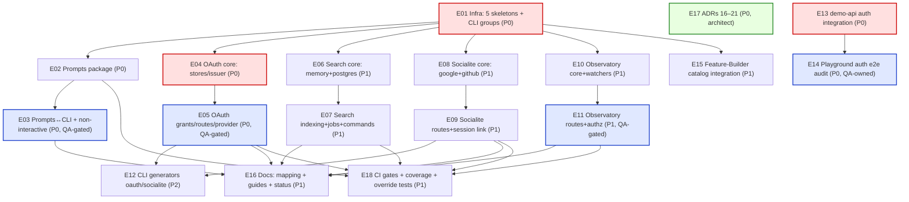

# Architecture — TypeScript Equivalents for Laravel First-Party Packages

**Author:** Bob (高见远), Architect · **Team:** `software-framework-completion` · **Language:** English
**Consumer:** `software-engineer` + `software-qa-engineer` · **Status:** Ready for implementation
**Inputs:** `docs/requirements/laravel-parity-scope.md`, `docs/architecture/laravel-parity-architecture.md` (T01–T22), `docs/architecture/end-to-end-delivery-plan.md` (W0–W6), `docs/status.md`, `docs/architecture/decisions.md` (ADR-1…ADR-15), and the **real** source under `packages/*/src` + `apps/{playground,demo-api}`.

> **Grounding & decision.** The user asked to "integrate the official Laravel first-party packages — Passport, Prompts, Scout, Socialite, Telescope". Those are **PHP/Composer** packages requiring **PHP + Laravel**; this repository has **zero PHP** (verified: no `composer.json`, no `artisan`, no `*.php`). The user therefore chose to **implement TypeScript equivalents inside this framework**, wired into the existing `@framework/*` architecture. This document designs those five equivalents as **first-class framework packages** following the established conventions: **contract + default binding + provider + capability honesty + `// @framework:*` marker registration + the `@framework/core` error catalog**. It also specifies **auth integration into `apps/demo-api`** and a **playground auth end-to-end audit plan**.
>
> This work is **net-new and additive** to the T01–T22 laravel-parity plan and its W0–W6 waves. Its task IDs use an **`E`-series** (`E01`…`E18`) to avoid colliding with `T01`–`T22`; §7 maps each `E`-task into the existing waves. It does **not** re-plan finished work (status.md §"Known limitations" and brief §9), and it **does not touch** the concurrent engineer workstream that is fixing lint/suite breakage.

---

## Part A — System Design

### 0. Package naming & Laravel mapping

Each equivalent is a **new workspace package** under `packages/*` (auto-included by the root `tsconfig.json` `include: ["packages/*/src", "packages/*/tests", …]` and the root `package.json` `workspaces: ["packages/*","apps/*"]`). Names follow the framework's subsystem-per-package convention; the Laravel name is documented for discoverability (the mapping doc is `docs/architecture/laravel-concept-map.md`).

| Laravel package | Framework package         | One-line scope                                                                            | Depends on (framework)                          | New runtime deps |
| --------------- | ------------------------- | ----------------------------------------------------------------------------------------- | ----------------------------------------------- | ---------------- |
| **Passport**    | `@framework/oauth-server` | OAuth2 authorization server (clients, grants, scopes, tokens, introspection)              | `auth`, `database`, `http`, `core`, `cache`     | **none**         |
| **Prompts**     | `@framework/prompts`      | Interactive CLI prompts (text/confirm/select/multiselect/password/spinner)                | `core` (types only)                             | **none**         |
| **Scout**       | `@framework/search`       | Driver-based search/indexing (memory + Postgres, pluggable backends)                      | `database`, `events`, `queue`, `core`           | **none**         |
| **Socialite**   | `@framework/socialite`    | OAuth social login (Google, GitHub) + account linking                                     | `auth`, `http`, `cache`, `core`                 | **none**         |
| **Telescope**   | `@framework/observatory`  | Dev observability/debug dashboard (request/query/job/event/exception/mail/cache watchers) | `http`, `events`, `database`, `logging`, `core` | **none**         |

> **Naming rationale.** `@framework/prompts` and `@framework/socialite` keep the Laravel names (generic enough). `Passport` → `oauth-server` and `Scout` → `search` use descriptive names to avoid trademark/tool ambiguity. `Telescope` → `observatory` is deliberate: it keeps the package clearly **distinct from the planned OpenTelemetry work** (M7 tracing/metrics) — a name like `telemetry` would collide conceptually (see ADR-20).

---

### 1. Implementation Approach

#### 1.1 Cross-cutting technical challenges

| #   | Challenge                                                     | Why it is hard                                                                                    | Approach                                                                                                                                                                                                                                                                                                                                                                            |
| --- | ------------------------------------------------------------- | ------------------------------------------------------------------------------------------------- | ----------------------------------------------------------------------------------------------------------------------------------------------------------------------------------------------------------------------------------------------------------------------------------------------------------------------------------------------------------------------------------- |
| C1  | **Reuse identity, never duplicate it** (Passport + Socialite) | OAuth/OIDC need their own client/token/consent state, but identity must stay in `@framework/auth` | Both packages **consume** `@framework/auth`'s `UserProvider`, `AuthService.startSession`, the session cookie guard and the `Principal` — they add **authorization/social state only**, never a second user table or a second session mechanism. OAuth access tokens are **JWT-format, signed with the framework JWKS**, so the existing `jwt` guard verifies them unchanged (§1.2). |
| C2  | **Zero new runtime dependencies**                             | Every added dep widens the peer boundary and the `bun build` external list                        | All five packages are implementable on what is already pinned: `jose@6` (JWT/JWKS/OIDC), `node:crypto` (hashing, PKCE, random), native `fetch` (outbound HTTP), `hono/jsx` (dashboard HTML), Drizzle `sql` (Postgres full-text). §1.3 proves the compatibility.                                                                                                                     |
| C3  | **Non-interactive-first CLI contract**                        | Prompts must never hang CI/`--json`/`--no-interaction`; exit codes are a frozen contract          | `@framework/prompts` separates **rendering** from **resolution**: a `PromptSession` resolves answers from (1) an injected answers map, (2) `default`, (3) a validator error, and only then (4) the TTY. `--no-interaction`/`--json` force path (1)/(2). Interrupt → `EXIT.INTERRUPTED (130)`.                                                                                       |
| C4  | **Queued-by-default indexing without a second event system**  | Scout must index on every write, but writes already publish domain events and queue jobs          | `@framework/search` subscribes to the **existing** `EventBus` channels (`<channel>.created                                                                                                                                                                                                                                                                                          | updated | deleted | restored`) and dispatches a **`defineIndexJob`** over `@framework/queue`(queued by default;`inline` for tests/dev). No new bus, no new worker. |
| C5  | **Honest capability reporting** (ADR-11)                      | Search backends and observability stores differ in capability; faking is forbidden                | `SearchEngine` and `ObservatoryStore` expose a **capability report**; an unsupported operation throws a catalogued error (`CAPABILITY_UNSUPPORTED`), never a silent no-op. The Postgres driver reports `fullText` honestly; a future Meilisearch adapter reports `typoTolerance`/`facets`.                                                                                          |
| C6  | **Never public by default** (ADR-8)                           | The Observatory dashboard and the OAuth authorize/consent screen are attack surfaces              | Observatory routes are **disabled outside dev/test unless explicitly enabled** and always mounted behind an authorization guard (`requireAbility('observatory.view')` or an explicit `authorize` callback, exactly like `auditRoutes`). OAuth `/authorize` requires an authenticated `Principal` (session guard) before consent.                                                    |
| C7  | **Observability ≠ tracing**                                   | The M7 OpenTelemetry plan (tracing/metrics/OTLP) must not be duplicated                           | Observatory is **in-app, per-request, dev-time inspection** (Laravel Telescope semantics). It records into a local store and never exports spans. It reuses the **same instrumentation seams** OTel would (a query observer, the kernel `report` hook) but owns no OTLP pipeline (ADR-20).                                                                                          |

#### 1.2 The two elegant reuse points

**(a) OAuth tokens the JWT guard already verifies.** `@framework/oauth-server` issues **JWT access tokens** signed by the framework's own JWKS (via `jose`, the same library the `jwt` guard uses). The existing guard (`packages/auth/src/jwt-guard.ts`) already:

- verifies RS/ES/PS/EdDSA against a JWKS with `kid` rotation,
- checks `iss`/`aud`,
- maps the `scope` claim (space-delimited) → abilities,
- resolves `sub` → local user via `UserProvider`.

So an access token minted by the OAuth server is accepted by **any** resource server using the framework's `jwt` guard **with no new code** — set `auth.jwt.jwksUri` (or inline `keys`) to the OAuth server's JWKS and the resource server trusts it. `@framework/oauth-server` additionally supports **opaque** tokens resolved through RFC 7662 introspection for clients that prefer them.

**(b) One identity source.** OAuth `userId` columns are FKs to the framework-owned `users` table; social accounts link to the same `users` rows; the authorize/consent screen authenticates through the existing **session** guard (`authPrincipal(c)`). No package re-implements `users`, sessions, password hashing, or 2FA.

#### 1.3 Library selections, pinned-version compatibility & dependency boundaries

Everything below is **already in the workspace**; **no new runtime dependency is introduced**. The optional future peers are named and bounded.

| Concern                            | Choice                                            | Pin                                      | Compatibility & boundary                                                                                                                                                  |
| ---------------------------------- | ------------------------------------------------- | ---------------------------------------- | ------------------------------------------------------------------------------------------------------------------------------------------------------------------------- |
| OAuth2/OIDC JWT + JWKS             | **`jose`**                                        | `6` (already a dep of `@framework/auth`) | Same lib/version the `jwt` guard uses; RS/ES/PS/EdDSA + `createLocalJWKSet`/`createRemoteJWKSet` + `jwtVerify`/`SignJWT`. Reused, not re-added.                           |
| Opaque token / code / PKCE entropy | **`node:crypto`**                                 | Bun builtin                              | `randomBytes`, `createHash('sha256')`, `createHash('base64url')` — identical discipline to `token-store.ts`/`session-store.ts`.                                           |
| Outbound provider HTTP (Socialite) | **native `fetch`**                                | Bun/Node builtin                         | No client lib. Retry/timeout via a tiny wrapper (mirrors the planned `Http::` helper, T13).                                                                               |
| Postgres full-text (Scout)         | **Drizzle `sql`** + `tsvector`/`to_tsquery`/`GIN` | `drizzle-orm@0.45.3`                     | Uses the existing `DatabaseConnection`; no `pg_trgm`/extension requirement beyond `tsvector` (core PostgreSQL 17).                                                        |
| Dashboard HTML (Observatory)       | **`hono/jsx`**                                    | `hono@4.13.12`                           | `jsxImportSource: hono/jsx` is already set in `tsconfig.base.json`; server-rendered, no frontend build.                                                                   |
| CLI raw-mode input (Prompts)       | **`node:readline`** + `process.stdin.setRawMode`  | Bun builtin                              | Bun implements `node:readline/promises` (already used in `run.ts`) and `process.stdin` raw mode; **line-mode readline fallback** if raw mode is unavailable (documented). |
| Hashing at rest                    | **`node:crypto` sha256**                          | Bun builtin                              | Same hash-at-rest rule as sessions/api-tokens/account-tokens.                                                                                                             |
| Validation & config                | **`zod@4.6.5`**                                   | pinned                                   | Config sections + request bodies; `z.toJSONSchema` for OpenAPI (via `@framework/openapi`).                                                                                |

**Dependency boundaries (enforced by the dependency-graph rule, architecture §8.12):**

```
@framework/oauth-server  →  auth, database, http, core, cache, hono, zod, jose, drizzle-orm
@framework/prompts       →  core (types), hono? NO — pure node;  node:readline
@framework/search        →  database, events, queue, core, hono, zod, drizzle-orm
@framework/socialite     →  auth, http, cache, core, hono, zod, jose
@framework/observatory   →  http, events, database, logging, core, hono, zod, drizzle-orm
```

- **No subsystem imports a `@mohamedhabibwork/*` kit** outside its adapter (ADR-11) — none of the five touch kits directly.
- **`@framework/prompts` is dependency-light by design**: it depends only on `@framework/core` **types** (for `JsonValue` discipline) and `node:*`; `@framework/cli` depends on **it** (not the reverse), so there is no cycle.
- **Optional future peers (NOT installed in this cut; named for the seam):**
  - `meilisearch@^0.4x` — Scout `meilisearch` driver. Boundary: `optionalDependencies`/`peerDependenciesMeta.optional = true`, loaded **inside** `packages/search/src/engines/meilisearch.ts`, kept **external** in `bun build` (matches the existing "optional peer SDKs kept external" rule).
  - `typesense@^2` — Scout `typesense` driver, same boundary.
  - No other peers are needed.

#### 1.4 SOLID + pattern mapping (per package, auditable)

| Package        | SRP                                            | OCP                                                                  | LSP                                                                   | ISP                                                                              | DIP                                                             | Patterns                                                                                                       |
| -------------- | ---------------------------------------------- | -------------------------------------------------------------------- | --------------------------------------------------------------------- | -------------------------------------------------------------------------------- | --------------------------------------------------------------- | -------------------------------------------------------------------------------------------------------------- |
| `oauth-server` | server vs grants vs stores vs issuer vs routes | new grant = new `GrantHandler`; new token format = new `TokenIssuer` | all grants satisfy `GrantHandler`; both issuers satisfy `TokenIssuer` | narrow `OAuthClientStore`/`OAuthCodeStore`/`OAuthTokenStore`/`OAuthConsentStore` | server → contracts; routes → `AuthorizationServer` via token    | **Strategy (grants, issuer), Repository (stores), Registry (grants/scopes), Template Method (grant pipeline)** |
| `prompts`      | renderer vs resolver vs each prompt type       | new prompt = new `Prompt` impl                                       | every prompt satisfies `Prompt`                                       | `Prompt`/`Validator`/`Renderer` are separate                                     | session → renderer abstraction; TTY renderer vs non-interactive | **Strategy (renderer), Builder (prompt chains), Null Object (non-interactive)**                                |
| `search`       | manager vs engine vs indexer vs jobs           | new backend = new `SearchEngine`; new index = `defineSearchIndex`    | all engines satisfy `SearchEngine`                                    | `SearchEngine` + `Indexer` split                                                 | manager → engine by config; indexer → queue contract            | **Ports & Adapters, Strategy (driver), Registry, Observer (event subscribe)**                                  |
| `socialite`    | manager vs driver vs account-store vs routes   | new provider = new `SocialProvider`                                  | all drivers satisfy `SocialProvider`                                  | `SocialProvider`, `SocialAccountStore` narrow                                    | routes → `SocialiteManager` via token; manager → driver         | **Strategy (driver), Registry, Adapter (provider → `SocialUser`), Facade-like manager**                        |
| `observatory`  | observatory vs watchers vs store vs routes     | new watcher = new `Watcher`; new store = new `ObservatoryStore`      | all watchers/stores satisfy their contracts                           | `Watcher`, `ObservatoryStore` narrow                                             | observatory → store; watchers → observatory                     | **Observer (watchers), Strategy (store), Decorator (mail/cache watchers), Registry**                           |

#### 1.5 Invariants that must survive (from brief §7 / architecture §1.7)

1. Native Hono `Context`/`Request`/`Response`/`next()` preserved; native middleware keeps working.
2. Error boundary is Hono's `onError`, **never** `try/catch` around `await next()` (ADR-5). Observatory's exception watcher uses the kernel `report` hook, not a wrapper.
3. Registration is **explicit** with `// @framework:*` markers (`insertAfterMarker`/`addImport`); missing markers/duplicates are errors (ADR-6).
4. Migrations are a **release step** (ADR-9): OAuth/social/observatory tables ship as generated Drizzle migrations applied via `db:migrate`.
5. Capabilities are **reported honestly**, never faked (ADR-11).
6. **Public access is never silently generated** (ADR-8): Observatory and OAuth consent are guarded by default.
7. `bun run test` (427 tests) stays green; the full-profile `create` output is unchanged (these packages are opt-in and additive).

---

### 2. File List

#### 2.1 Net-new files

**`packages/oauth-server/` (Passport)**

```
packages/oauth-server/package.json
packages/oauth-server/tsconfig.json
packages/oauth-server/src/index.ts                 # public API
packages/oauth-server/src/types.ts                 # every interface/type
packages/oauth-server/src/constants.ts             # DI tokens + fixed defaults
packages/oauth-server/src/config-schema.ts         # validated `oauth` config section
packages/oauth-server/src/schema/tables.ts         # oauth_clients, oauth_auth_codes, oauth_access_tokens, oauth_refresh_tokens, oauth_consents
packages/oauth-server/src/client-store.ts          # PgOAuthClientStore (client_secret hashed at rest)
packages/oauth-server/src/code-store.ts            # PgOAuthCodeStore (single-use auth codes + PKCE challenge)
packages/oauth-server/src/token-store.ts           # PgOAuthTokenStore (access + refresh, hashed/revocable)
packages/oauth-server/src/consent-store.ts         # PgOAuthConsentStore (per user+client scopes)
packages/oauth-server/src/scopes.ts                # ScopeRegistry (name/description/implies)
packages/oauth-server/src/token-issuer.ts          # TokenIssuer: JwtTokenIssuer (jose) + OpaqueTokenIssuer
packages/oauth-server/src/grants/authorization-code.ts
packages/oauth-server/src/grants/client-credentials.ts
packages/oauth-server/src/grants/refresh-token.ts
packages/oauth-server/src/grants/index.ts          # GrantRegistry
packages/oauth-server/src/server.ts                # AuthorizationServer orchestrator
packages/oauth-server/src/routes.ts                # authorize/consent/token/introspect/revoke/metadata
packages/oauth-server/src/provider.ts              # createOAuthServerProvider
packages/oauth-server/tests/grants.test.ts
packages/oauth-server/tests/pkce.test.ts
packages/oauth-server/tests/introspection.test.ts
packages/oauth-server/tests/routes.test.ts
```

**`packages/prompts/` (Prompts)**

```
packages/prompts/package.json
packages/prompts/tsconfig.json
packages/prompts/src/index.ts
packages/prompts/src/types.ts                      # Prompt, Validator, Renderer, PromptAnswer
packages/prompts/src/constants.ts                  # ANSI codes, defaults
packages/prompts/src/renderer.ts                   # TtyRenderer (ANSI/raw mode) + NonInteractiveRenderer
packages/prompts/src/session.ts                    # PromptSession (answers map, non-interactive fallback, signal)
packages/prompts/src/validate.ts                   # validators + combinators
packages/prompts/src/text.ts
packages/prompts/src/confirm.ts
packages/prompts/src/select.ts
packages/prompts/src/multiselect.ts
packages/prompts/src/password.ts
packages/prompts/src/spinner.ts
packages/prompts/tests/prompts.test.ts
packages/prompts/tests/non-interactive.test.ts
packages/prompts/tests/validation.test.ts
```

**`packages/search/` (Scout)**

```
packages/search/package.json
packages/search/tsconfig.json
packages/search/src/index.ts
packages/search/src/types.ts                       # SearchEngine, SearchIndex, SearchQuery, SearchResult
packages/search/src/constants.ts                   # SEARCH_ENGINE token, SEARCH_MANAGER token
packages/search/src/config-schema.ts               # validated `search` section (driver: memory|postgres|...)
packages/search/src/engine.ts                      # SearchEngine contract + tokenizer/capability report
packages/search/src/engines/memory.ts              # MemorySearchEngine
packages/search/src/engines/postgres.ts            # PostgresSearchEngine (tsvector + GIN)
packages/search/src/index-definition.ts            # defineSearchIndex({ name, source, searchable, filterable, softDelete })
packages/search/src/searchable.ts                  # Searchable mixin (declares searchable fields)
packages/search/src/indexer.ts                     # Indexer (event subscribe + soft-delete awareness)
packages/search/src/jobs.ts                        # defineIndexJob (queued by default)
packages/search/src/manager.ts                     # SearchManager (driver registry)
packages/search/src/provider.ts                    # createSearchProvider
packages/search/tests/memory.test.ts
packages/search/tests/postgres.test.ts
packages/search/tests/indexer.test.ts
packages/search/tests/paginate.test.ts
```

**`packages/socialite/` (Socialite)**

```
packages/socialite/package.json
packages/socialite/tsconfig.json
packages/socialite/src/index.ts
packages/socialite/src/types.ts                    # SocialProvider, SocialUser, SocialAccountStore, SocialiteConfig
packages/socialite/src/constants.ts                # SOCIALITE_MANAGER token
packages/socialite/src/config-schema.ts            # validated `socialite` section (providers, redirects, linkByEmail)
packages/socialite/src/schema/tables.ts            # social_accounts (provider, provider_user_id, user_id)
packages/socialite/src/provider-contract.ts        # SocialProvider (redirectUrl/exchangeCode/fetchUser/verifyIdToken)
packages/socialite/src/drivers/google.ts           # Google OIDC (authorize/token/userinfo/id_token via jose)
packages/socialite/src/drivers/github.ts           # GitHub OAuth2 (authorize/token/user + /user/emails)
packages/socialite/src/drivers/index.ts            # driver registry
packages/socialite/src/manager.ts                  # SocialiteManager
packages/socialite/src/account-store.ts            # PgSocialAccountStore
packages/socialite/src/routes.ts                   # redirect/callback/token
packages/socialite/src/provider.ts                 # createSocialiteProvider
packages/socialite/tests/google.test.ts
packages/socialite/tests/github.test.ts
packages/socialite/tests/linking.test.ts
packages/socialite/tests/routes.test.ts
```

**`packages/observatory/` (Telescope)**

```
packages/observatory/package.json
packages/observatory/tsconfig.json
packages/observatory/src/index.ts
packages/observatory/src/types.ts                  # Watcher, ObservatoryStore, ObservatoryEntry, WatcherName
packages/observatory/src/constants.ts              # OBSERVATORY token
packages/observatory/src/config-schema.ts          # validated `observatory` section (enabled, driver, retention, watchers)
packages/observatory/src/schema/tables.ts          # observatory_entries
packages/observatory/src/store.ts                  # ObservatoryStore contract + capability report
packages/observatory/src/stores/memory.ts          # MemoryObservatoryStore (bounded ring buffer)
packages/observatory/src/stores/postgres.ts        # PgObservatoryStore
packages/observatory/src/observatory.ts            # Observatory service (record/query/prune/clear)
packages/observatory/src/watchers/request.ts       # Hono middleware
packages/observatory/src/watchers/query.ts         # Drizzle query observer seam
packages/observatory/src/watchers/job.ts           # queue job watcher
packages/observatory/src/watchers/event.ts         # EventBus watcher
packages/observatory/src/watchers/exception.ts     # kernel report hook
packages/observatory/src/watchers/mail.ts          # MailTransport decorator
packages/observatory/src/watchers/cache.ts         # cache engine decorator
packages/observatory/src/routes.ts                 # /admin/observatory JSON + hono/jsx HTML
packages/observatory/src/provider.ts               # createObservatoryProvider
packages/observatory/tests/watchers.test.ts
packages/observatory/tests/store.test.ts
packages/observatory/tests/authorization.test.ts
packages/observatory/tests/prune.test.ts
```

**CLI surface (new commands + generators)**

```
packages/cli/src/commands/oauth.ts                 # oauth:client:create/list, oauth:key:generate
packages/cli/src/commands/search.ts                # search:index, search:flush, search:status
packages/cli/src/commands/observatory.ts           # observatory:list, observatory:prune, observatory:clear
packages/cli/src/commands/socialite.ts             # socialite:providers (list configured providers)
packages/cli/src/context/prompts.ts                # CommandContext → PromptSession adapter
packages/cli/src/generators/oauth/generate.ts
packages/cli/src/generators/oauth/templates.ts     # make:oauth-client scaffold
packages/cli/src/generators/socialite/generate.ts
packages/cli/src/generators/socialite/templates.ts # make:socialite-provider scaffold
packages/cli/tests/prompts.test.ts
packages/cli/tests/package-equivalents.test.ts     # oauth/search/observatory/socialite command gates
```

**demo-api auth integration (net-new)**

```
apps/demo-api/app/modules/auth/provider.ts         # generated by make:auth
apps/demo-api/app/modules/auth/routes.ts
apps/demo-api/app/modules/auth/index.ts
apps/demo-api/database/migrations/0001_create-auth-tables.sql
apps/demo-api/tests/auth.api.test.ts               # auth smoke suite
```

**Docs & audit artifacts**

```
docs/architecture/laravel-concept-map.md           # extended with the 5 mappings (T21 file)
apps/docs/src/content/docs/guides/oauth-server.mdx
apps/docs/src/content/docs/guides/prompts.mdx
apps/docs/src/content/docs/guides/search.mdx
apps/docs/src/content/docs/guides/socialite.mdx
apps/docs/src/content/docs/guides/observatory.mdx
docs/architecture/auth-e2e-audit.md                # playground auth audit plan + evidence
docs/architecture/package-equivalents-class-diagram.mermaid
docs/architecture/package-equivalents-sequence-diagram.mermaid
```

#### 2.2 Modified files

```
docs/architecture/decisions.md                     # + ADR-16…ADR-21
docs/status.md                                     # + 5 package rows, + command rows, + known limitations
packages/cli/src/command.ts                        # CommandGroup union += 'oauth'|'search'|'observatory'|'socialite'; CommandContext += prompts
packages/cli/src/run.ts                            # construct the PromptSession and expose it on CommandContext
packages/cli/src/commands/index.ts                 # register oauth/search/observatory/socialite command groups
packages/cli/src/commands/planned.ts               # remove any of the above that were listed as planned
packages/cli/package.json                          # + "@framework/prompts": "workspace:*"
packages/database/src/connections/connection.ts    # optional QueryObserver/logger seam (for the query watcher)
packages/database/src/index.ts                     # export the query-observer seam types
packages/events/src/bus.ts                          # optional wildcard subscribe (or documented per-channel subscribe)
packages/features/src/types.ts                      # FeatureName union += 'oauth'|'prompts'|'search'|'socialite'|'observatory'
packages/features/src/catalog.ts                    # descriptors for the 5 new subsystems
.github/workflows/ci.yml                            # new package suites + observatory/search real-infra jobs
scripts/coverage.ts                                 # per-package thresholds for the 5 new packages
# demo-api integration edits:
apps/demo-api/package.json                          # + "@framework/auth": "workspace:*"
apps/demo-api/config/index.ts                       # + auth section (schema + env)
apps/demo-api/database/schema/index.ts              # + auth tables export
apps/demo-api/bootstrap/providers.ts                # + authProvider
apps/demo-api/bootstrap/http.ts                     # + resolveActor: authActorResolver + /api/v1/auth mount
```

> **No root `tsconfig.json` / root `package.json` change is required** — `packages/*` and `packages/*/src|tests` are globbed. The only manifest edits are the two package-local `package.json` files above and the lockfile.

---

### 3. Data Structures & Interfaces

Full diagram: `docs/architecture/package-equivalents-class-diagram.mermaid`. Key contracts:

```ts
// ── @framework/oauth-server (Passport) ───────────────────────────────────────
type OAuthGrantType = 'authorization_code' | 'client_credentials' | 'refresh_token';
type OAuthClientType = 'confidential' | 'public';

interface OAuthClient {
  readonly id: string;
  readonly name: string;
  readonly type: OAuthClientType;
  readonly redirectUris: readonly string[];
  readonly allowedGrants: readonly OAuthGrantType[];
  readonly allowedScopes: readonly string[];
  /** Hashed at rest; absent for public clients (which must use PKCE). */
  readonly secretHash?: string;
}

interface OAuthClientStore {
  find(id: string): Promise<OAuthClient | null>;
  /** Constant-time secret verification; false for public clients. */
  verifySecret(id: string, secret: string): Promise<boolean>;
  register(input: RegisterClientInput): Promise<{ client: OAuthClient; secret?: string }>;
  list(): Promise<readonly OAuthClient[]>;
}

interface OAuthCodeStore {
  issue(input: IssueCodeInput): Promise<string>; // plaintext, single-use
  consume(code: string, clientId: string): Promise<OAuthCodeRecord | null>; // PKCE-verified by caller
}

interface OAuthTokenStore {
  issueAccess(input: IssueAccessInput): Promise<IssuedAccessToken>;
  issueRefresh(input: IssueRefreshInput): Promise<string>;
  findAccess(token: string): Promise<OAuthAccessRecord | null>;
  findRefresh(token: string): Promise<OAuthRefreshRecord | null>;
  revoke(token: string): Promise<boolean>;
  revokeAllForUser(userId: string): Promise<number>;
  prune(now?: Date): Promise<number>;
}

interface OAuthConsentStore {
  grantedScopes(userId: string, clientId: string): Promise<readonly string[]>;
  grant(userId: string, clientId: string, scopes: readonly string[]): Promise<void>;
  revoke(userId: string, clientId: string): Promise<void>;
}

interface ScopeRegistry {
  register(scope: Scope): void;
  all(): readonly Scope[];
  validate(names: readonly string[]): string[];
}

/** Token format strategy. JwtTokenIssuer signs with the framework JWKS so the existing jwt guard verifies it. */
interface TokenIssuer {
  readonly format: 'jwt' | 'opaque';
  issue(claims: AccessClaims): Promise<string>;
  verify(token: string): Promise<AccessClaims | null>;
}
interface GrantHandler {
  readonly type: OAuthGrantType;
  /** Client auth + request validation + token issuance for one grant. */
  handle(request: TokenRequest, deps: GrantDeps): Promise<TokenResponse>;
}

class AuthorizationServer {
  constructor(deps: AuthorizationServerDeps);
  authorize(request: AuthorizeRequest, principal: Principal): Promise<AuthorizeDecision>; // consent or redirect
  consent(principal: Principal, decision: ConsentDecision): Promise<string>; // code
  token(request: TokenRequest): Promise<TokenResponse>;
  introspect(token: string): Promise<IntrospectionResponse>; // RFC 7662
  revoke(token: string): Promise<void>; // RFC 7009
}

// ── @framework/prompts (Prompts) ─────────────────────────────────────────────
type PromptAnswer = string | boolean | number | readonly string[];
interface Validator<T> {
  (value: T): string | null;
} // null = valid, string = message

interface Prompt<T extends PromptAnswer> {
  readonly kind: 'text' | 'confirm' | 'select' | 'multiselect' | 'password' | 'spinner';
  readonly message: string;
  readonly defaultValue?: T;
  readonly validate?: Validator<T>;
  run(renderer: Renderer): Promise<T>;
}

interface Renderer {
  readonly interactive: boolean;
  /** Resolves an answer; non-interactive renderers read the answers map or the default. */
  ask<T extends PromptAnswer>(prompt: Prompt<T>): Promise<T>;
  readonly spinner: SpinnerControl;
}

interface PromptSession {
  text(opts: TextOptions): Promise<string>;
  confirm(opts: ConfirmOptions): Promise<boolean>;
  select<T extends string>(opts: SelectOptions<T>): Promise<T>;
  multiselect<T extends string>(opts: MultiSelectOptions<T>): Promise<readonly T[]>;
  password(opts: PasswordOptions): Promise<string>;
  spinner(label: string): SpinnerControl;
  /** Injected answers (tests, `--answers`, scripted runs). */
  readonly answers?: Readonly<Record<string, PromptAnswer>>;
}

// ── @framework/search (Scout) ────────────────────────────────────────────────
interface SearchCapabilities {
  readonly fullText: boolean;
  readonly filters: boolean;
  readonly typoTolerance: boolean;
  readonly facets: boolean;
}

interface SearchEngine {
  readonly name: string;
  readonly capabilities: SearchCapabilities;
  upsert(index: string, docs: readonly SearchDocument[]): Promise<void>;
  remove(index: string, ids: readonly string[]): Promise<void>;
  flush(index: string): Promise<void>;
  search(index: string, query: SearchQuery): Promise<SearchResult>;
  paginate(index: string, query: SearchQuery, page: PageRequest): Promise<Page<SearchHit>>;
}

interface SearchIndex<TTable extends CrudTable> {
  readonly name: string;
  readonly source: TTable;
  readonly searchable: readonly string[];
  readonly filterable: readonly string[];
  readonly softDelete: boolean;
  project(row: SelectOf<TTable>): SearchDocument;
}

class Indexer {
  /** Subscribes to `<channel>.<verb>` events; dispatches a queued (or inline) index job. */
  register<TTable extends CrudTable>(index: SearchIndex<TTable>, opts: IndexerOptions): Unsubscribe;
}

// ── @framework/socialite (Socialite) ─────────────────────────────────────────
interface SocialUser {
  readonly id: string; // provider user id
  readonly name: string;
  readonly email: string | null;
  readonly emailVerified: boolean;
  readonly avatarUrl: string | null;
  readonly raw: JsonObject;
}

interface SocialProvider {
  readonly name: string; // 'google' | 'github' | ...
  readonly usesPkce: boolean;
  redirectUrl(input: RedirectInput): string;
  exchangeCode(input: ExchangeInput): Promise<{ accessToken: string; idToken?: string }>;
  fetchUser(accessToken: string, idToken?: string): Promise<SocialUser>;
}

interface SocialAccountStore {
  find(provider: string, providerUserId: string): Promise<{ userId: string } | null>;
  link(provider: string, providerUserId: string, userId: string): Promise<void>;
  unlink(userId: string, provider: string): Promise<boolean>;
}

class SocialiteManager {
  driver(name: string): SocialProvider;
  providers(): readonly string[];
}

// ── @framework/observatory (Telescope) ───────────────────────────────────────
type WatcherName = 'request' | 'query' | 'job' | 'event' | 'exception' | 'mail' | 'cache';
interface ObservatoryEntry {
  readonly id: string;
  readonly watcher: WatcherName;
  readonly summary: string;
  readonly payload: JsonObject;
  readonly durationMs: number | null;
  readonly status: 'ok' | 'error';
  readonly actor: Actor;
  readonly correlationId: string;
  readonly occurredAt: string;
}
interface Watcher {
  readonly name: WatcherName;
  record(entry: Omit<ObservatoryEntry, 'id' | 'watcher'>): Promise<void>;
}
interface ObservatoryStore {
  readonly capabilities: { readonly query: boolean; readonly prune: boolean };
  write(entry: ObservatoryEntry): Promise<void>;
  query(filter: ObservatoryQuery): Promise<readonly ObservatoryEntry[]>;
  prune(before: Date): Promise<number>;
  clear(): Promise<void>;
}
class Observatory {
  constructor(deps: { store: ObservatoryStore; enabled: boolean; sampleRate: number });
  record(entry: Omit<ObservatoryEntry, 'id'>): Promise<void>;
  query(filter: ObservatoryQuery): Promise<readonly ObservatoryEntry[]>;
  prune(before?: Date): Promise<number>;
}
```

---

### 4. Program Call Flow

Full diagrams: `docs/architecture/package-equivalents-sequence-diagram.mermaid`. The three required flows:

**(a) OAuth2 `authorization_code` + PKCE exchange** — summarized:
`Client → GET /oauth/authorize?response_type=code&client_id&redirect_uri&scope&code_challenge&state` → `requireAuth()` resolves the session `Principal` (existing `@framework/auth` guard) → `AuthorizationServer.authorize()` validates client/redirect/scope, checks `OAuthConsentStore.grantedScopes` → if consent missing, render consent (guarded) → on approve `OAuthCodeStore.issue()` (single-use code, stores `code_challenge`) → 302 `redirect_uri?code&state`. Then `Client → POST /oauth/token` (`grant_type=authorization_code&code&code_verifier&client_id[&client_secret]`) → `AuthorizationCodeGrant.handle()` → client auth (`OAuthClientStore.verifySecret` for confidential; PKCE `SHA256(code_verifier)==code_challenge` for public) → `OAuthCodeStore.consume()` → `TokenIssuer.issue()` (JWT signed with the framework JWKS; `scope` claim) + `OAuthTokenStore.issueAccess()/issueRefresh()` → `200 { access_token, token_type: "Bearer", expires_in, refresh_token, scope }`. A resource server then verifies the access token with the **existing `jwt` guard** (no new code).

**(b) Social-login redirect → callback → session** — summarized:
`Browser → GET /api/v1/auth/social/google/redirect` → `SocialiteManager.driver('google').redirectUrl()` builds the authorize URL with `state` + PKCE `code_verifier` (verifier cached under `socialite:state:<state>` with a short TTL) → 302 to Google. `Google → GET /api/v1/auth/social/google/callback?code&state` → verify `state` (cache consume), `driver.exchangeCode()` (native `fetch`), `driver.fetchUser()` (userinfo / `id_token` verified with `jose`) → `SocialAccountStore.find(provider, providerUserId)` → if absent, `UserProvider.findByEmail()` then link, else create a local user (no password) + link → `AuthService.startSession(user.id)` → `setCookie` (the **same** session cookie the session guard reads) → 302 to the app. All existing session-based auth, `/me`, policies and 2FA then apply unchanged. **Outbound vs inbound:** the provider token is never accepted as an API credential; social login always terminates in a framework session (or an app-issued API token).

**(c) Queued index write → search read** — summarized:
`POST /products` → `ResourceController → ResourceService.create()` → `repository.create()` (committed) → `ResourceService.#publish('created', entity)` on the existing `EventBus` channel `products` → `Indexer` (subscribed to `products.created`) dispatches `defineIndexJob` over `@framework/queue` (`queue.add('search.index', { index, doc })`) → worker runs the job → `SearchEngine.upsert('products', [doc])` (soft-delete aware: a `deleted`/`restored` event removes/re-adds). Read path: `GET /search/products?q=…` → `SearchManager.engine()` → `SearchEngine.search()/paginate()` → `Page<SearchHit>` (reusing `@framework/database` `Page`/`toPage`). Inline mode (`indexing: 'inline'`) skips the queue for dev/tests.

---

### 5. Required ADRs (next free numbers: ADR-16+)

- **ADR-16 — OAuth2 authorization server as a first-class package (`@framework/oauth-server`).** Implement OAuth2 (RFC 6749) + PKCE (RFC 7636) + introspection (RFC 7662) + revocation (RFC 7009) + authorization-server metadata (RFC 8414) in TypeScript over `jose`/`node:crypto`. **Access tokens are JWT-format, signed with the framework JWKS**, so the existing `jwt` guard verifies them unchanged; opaque tokens are supported via introspection. Identity is **reused** from `@framework/auth` (`UserProvider`, session guard) — no second user/session store. Zero new runtime deps.
- **ADR-17 — Prompts as a zero-dependency, non-interactive-first CLI prompt library (`@framework/prompts`).** Rendering is separated from resolution; `--no-interaction`/`--json` force defaults/injected answers; interrupts map to `EXIT.INTERRUPTED (130)`; validation failures map to `EXIT.USAGE (2)`. No third-party prompt library. `@framework/cli` depends on it (never the reverse).
- **ADR-18 — Driver-based search with a memory + Postgres driver (`@framework/search`).** `SearchEngine` is a port; `memory` (dev/tests) and `postgres` (tsvector + GIN) ship first; external backends (Meilisearch/Typesense) are **documented optional-peer adapter seams kept external in `bun build`** — not implemented in this cut. Indexing is **queued by default** over `@framework/queue`, wired from the existing `EventBus`; soft-delete awareness is mandatory.
- **ADR-19 — Outbound social login distinct from the inbound JWT/JWK guard (`@framework/socialite`).** The `jwt` guard performs **inbound** verification of tokens presented to the API; Socialite performs **outbound** OAuth/OIDC against third-party providers (native `fetch` + `jose` for `id_token`) and always terminates in a **framework session/API token** — a provider token is never a framework credential. Account linking policy (`linkByEmail`, verified-email requirement) is explicit configuration, never a silent merge.
- **ADR-20 — Observatory is a dev observability dashboard, not a tracing pipeline (`@framework/observatory`).** Telescope-equivalent in-app, per-request, dev-time inspection with a local store (memory + Postgres) and retention/pruning. It is **not** the planned OpenTelemetry tracing/metrics/OTLP work (M7) and does not duplicate it; it reuses the same instrumentation seams (query observer, kernel `report` hook) but owns no exporter. Dashboard routes are **never public by default** (ADR-8): disabled outside dev/test unless explicitly enabled and always authorization-guarded.
- **ADR-21 — demo-api auth integration via the existing `make:auth` path (no divergence).** `apps/demo-api` gains auth through the **same** generator/plan the playground and generated apps use (`make:auth --guards session,api-token`): dependency + module + config + schema + provider + kernel-guard + route-mount edits + migration. No bespoke wiring; the generator's change set is the contract, and a smoke suite proves it.

---

## Part B — Task Decomposition

### 6. Required Packages

Existing pins are **unchanged**; **no new runtime dependency is added** by this work.

```
# already pinned & reused (no change)
bun@1.4.2 · typescript@5.9.3 · @biomejs/biome@2.5.15
hono@4.13.12 · zod@4.6.5 · @hono/zod-validator@0.9.1
drizzle-orm@0.45.3 · drizzle-kit@0.31.11 · drizzle-zod@0.8.3 · postgres@3.4.9
jose@6            # reused by oauth-server + socialite (already a dep of @framework/auth)
bullmq@6.3.11 · ioredis@5.8.2

# NEW workspace packages (zero external deps)
@framework/oauth-server@0.1.0   # workspace:*
@framework/prompts@0.1.0        # workspace:*
@framework/search@0.1.0         # workspace:*
@framework/socialite@0.1.0      # workspace:*
@framework/observatory@0.1.0    # workspace:*

# NEW internal wiring dependency (workspace only)
@framework/cli  →  + "@framework/prompts": "workspace:*"

# DOCUMENTED optional peers (NOT installed in this cut; kept EXTERNAL in `bun build`)
meilisearch@^0.4x   # @framework/search meilisearch driver  (optional peer, external)
typesense@^2        # @framework/search typesense driver    (optional peer, external)
```

> **Rule honored:** optional peers stay **external** in `bun build` (matches the existing "optional storage/notifications peer SDKs kept external" behaviour). No peer is required for any P0/P1 flow.

### 7. Task List (ordered by dependency)

> **Rules honored:** the **first task (E01) is infrastructure** (manifests + package skeletons + entry files + CLI group registration, in ONE task); every task groups **≥3 related files**; grouped **by subsystem**, never one-file-per-task. Task IDs are an **`E`-series** (additive to the existing `T01`–`T22`); the **Wave** column maps each into the existing W0–W6 plan. Owners: `software-engineer` (impl), `software-qa-engineer` (audit/verification), `software-architect` (ADRs). **The concurrent lint/suite-fix workstream is out of scope here — do not duplicate it.**

| Task    | Name                                                                                | Source files                                                                                                                                                                                                                                                                                                                     | Depends on                                     | Priority | Owner                    | Wave   | Parallelization note                                                                                           |
| ------- | ----------------------------------------------------------------------------------- | -------------------------------------------------------------------------------------------------------------------------------------------------------------------------------------------------------------------------------------------------------------------------------------------------------------------------------- | ---------------------------------------------- | -------- | ------------------------ | ------ | -------------------------------------------------------------------------------------------------------------- |
| **E01** | **Infrastructure: 5 package skeletons + CLI group wiring**                          | `packages/{oauth-server,prompts,search,socialite,observatory}/{package.json,tsconfig.json,src/index.ts,src/types.ts,src/constants.ts}`, `packages/cli/src/command.ts` (CommandGroup union + `CommandContext.prompts`), `packages/cli/src/commands/index.ts`, `packages/cli/src/commands/planned.ts`, `packages/cli/package.json` | —                                              | P0       | software-engineer        | W0-ext | **Unblocks all E-tasks.** Do not parallelize the skeleton/registry edits. Only touches new dirs + 3 CLI files. |
| **E02** | **Prompts package (renderer + all prompt types + validators)**                      | `packages/prompts/src/{renderer,session,validate,text,confirm,select,multiselect,password,spinner}.ts`, `packages/prompts/tests/{prompts,validation}.test.ts`                                                                                                                                                                    | E01                                            | P0       | software-engineer        | W3     | Parallel (needs only E01). Zero deps — safest first package.                                                   |
| **E03** | **Prompts ↔ CLI integration + non-interactive contract**                            | `packages/cli/src/context/prompts.ts`, `packages/cli/src/run.ts`, `packages/cli/src/command.ts`, `packages/cli/tests/prompts.test.ts`, `packages/prompts/tests/non-interactive.test.ts`                                                                                                                                          | E02                                            | P0       | software-engineer        | W3     | After E02. Freezes the `--no-interaction`/`--json`/exit-code behaviour; QA reviews.                            |
| **E04** | **OAuth2 server core (contracts + schema + stores + scopes + issuer)**              | `packages/oauth-server/src/{config-schema,schema/tables,client-store,code-store,token-store,consent-store,scopes,token-issuer}.ts`, `packages/oauth-server/tests/introspection.test.ts`                                                                                                                                          | E01                                            | P0       | software-engineer        | W3     | Parallel with E02/E06/E08/E10. Needs only E01.                                                                 |
| **E05** | **OAuth2 grants + server + routes + provider**                                      | `packages/oauth-server/src/grants/*`, `packages/oauth-server/src/{server,routes,provider}.ts`, `packages/oauth-server/tests/{grants,pkce,routes}.test.ts`                                                                                                                                                                        | E04                                            | P0       | software-engineer        | W3     | Sequential after E04. QA-gated (RFC conformance: PKCE, single-use codes, introspection).                       |
| **E06** | **Search core (engine contract + memory + postgres drivers + index definition)**    | `packages/search/src/{config-schema,engine,engines/memory,engines/postgres,index-definition}.ts`, `packages/search/tests/{memory,postgres}.test.ts`                                                                                                                                                                              | E01                                            | P1       | software-engineer        | W3     | Parallel (needs only E01). Postgres driver needs real PostgreSQL for its test.                                 |
| **E07** | **Search indexing wiring + jobs + provider + re-index commands**                    | `packages/search/src/{searchable,indexer,jobs,manager,provider}.ts`, `packages/cli/src/commands/search.ts`, `packages/search/tests/{indexer,paginate}.test.ts`, `packages/cli/tests/package-equivalents.test.ts`                                                                                                                 | E06                                            | P1       | software-engineer        | W3     | After E06. Needs `@framework/events`+`@framework/queue` (exist).                                               |
| **E08** | **Socialite core (contract + Google + GitHub drivers + manager + account store)**   | `packages/socialite/src/{config-schema,schema/tables,provider-contract,drivers/google,drivers/github,drivers/index,manager,account-store}.ts`, `packages/socialite/tests/{google,github}.test.ts`                                                                                                                                | E01                                            | P1       | software-engineer        | W3     | Parallel (needs only E01). Drivers tested against a fetch fake.                                                |
| **E09** | **Socialite routes + auth session integration**                                     | `packages/socialite/src/{routes,provider}.ts`, `packages/socialite/tests/{linking,routes}.test.ts`, `packages/cli/src/commands/socialite.ts`                                                                                                                                                                                     | E08                                            | P1       | software-engineer        | W3     | After E08. Needs `@framework/auth` (exists). Freezes account-linking policy.                                   |
| **E10** | **Observatory core (contract + stores + watchers + query seam)**                    | `packages/observatory/src/{config-schema,schema/tables,store,stores/memory,stores/postgres,observatory}.ts`, `packages/observatory/src/watchers/*.ts`, `packages/observatory/tests/{watchers,store}.test.ts`, `packages/database/src/connections/connection.ts`, `packages/database/src/index.ts`, `packages/events/src/bus.ts`  | E01                                            | P1       | software-engineer        | W3     | Parallel (needs only E01). Adds the query-observer + wildcard-subscribe seams.                                 |
| **E11** | **Observatory routes + authorization + prune/schedule + commands**                  | `packages/observatory/src/{routes,provider}.ts`, `packages/cli/src/commands/observatory.ts`, `packages/observatory/tests/{authorization,prune}.test.ts`                                                                                                                                                                          | E10                                            | P1       | software-engineer        | W3     | After E10. **Authorization is the gate** (never public by default, ADR-8/ADR-20).                              |
| **E12** | **CLI generators: `make:oauth-client`, `make:socialite-provider` + oauth commands** | `packages/cli/src/generators/oauth/{generate,templates}.ts`, `packages/cli/src/generators/socialite/{generate,templates}.ts`, `packages/cli/src/commands/oauth.ts`, `packages/cli/tests/package-equivalents.test.ts`                                                                                                             | E05, E09                                       | P2       | software-engineer        | W4     | After E05+E09. Uses the shared plan/conflict/`--dry-run` pipeline (no new strategy).                           |
| **E13** | **demo-api auth integration (make:auth-equivalent)**                                | `apps/demo-api/package.json`, `apps/demo-api/app/modules/auth/{provider,routes,index}.ts`, `apps/demo-api/config/index.ts`, `apps/demo-api/database/schema/index.ts`, `apps/demo-api/bootstrap/{providers,http}.ts`, `apps/demo-api/database/migrations/0001_create-auth-tables.sql`, `apps/demo-api/tests/auth.api.test.ts`     | — (needs existing `make:auth`, T-phase-3 done) | P0       | software-engineer        | W3     | **Independent** — needs only the existing auth package + CLI. Can start immediately in parallel with E01.      |
| **E14** | **Playground auth end-to-end audit**                                                | `packages/auth/tests/e2e-auth-flows.test.ts`, `docs/architecture/auth-e2e-audit.md`, evidence under `apps/playground/tests/`                                                                                                                                                                                                     | E13                                            | P0       | **software-qa-engineer** | W5     | **QA-owned.** After E13. Covers register/login/2FA/logout/me/verify/reset/tokens/jwt.                          |
| **E15** | **Feature-Builder catalog integration for the 5 subsystems**                        | `packages/features/src/types.ts`, `packages/features/src/catalog.ts`, `packages/cli/src/features/manifest.ts`, `packages/features/tests/catalog.test.ts`, `packages/cli/tests/features.test.ts`                                                                                                                                  | E01 (+ Feature Builder T03/T04)                | P1       | software-engineer        | W1/W5  | After the Feature Builder core exists; makes the 5 opt-in/removable (composability).                           |
| **E16** | **Docs: Laravel-concept mapping + package guides + status**                         | `docs/architecture/laravel-concept-map.md`, `apps/docs/src/content/docs/guides/{oauth-server,prompts,search,socialite,observatory}.mdx`, `docs/status.md`                                                                                                                                                                        | E02–E11                                        | P1       | software-engineer        | W5     | After the packages land (docs quote frozen contracts).                                                         |
| **E17** | **ADRs ADR-16…ADR-21**                                                              | `docs/architecture/decisions.md`                                                                                                                                                                                                                                                                                                 | —                                              | P0       | **software-architect**   | W0-ext | Can land immediately (text specified in §5).                                                                   |
| **E18** | **CI gates + coverage thresholds + override tests for the 5 packages**              | `.github/workflows/ci.yml`, `scripts/coverage.ts`, `packages/{oauth-server,prompts,search,socialite,observatory}/tests/*.override.test.ts`                                                                                                                                                                                       | E02–E11                                        | P1       | software-engineer        | W5     | After the packages land. One override test per package (contract + default binding + app fake).                |

#### 7.1 Owner summary

| Owner                    | Tasks                                                                          | Count            |
| ------------------------ | ------------------------------------------------------------------------------ | ---------------- |
| **software-engineer**    | E01, E02, E03, E04, E05, E06, E07, E08, E09, E10, E11, E12, E13, E15, E16, E18 | 16               |
| **software-qa-engineer** | E14 (+ review gate on E03, E05, E11)                                           | 1 owned, 3 gated |
| **software-architect**   | E17 (ADRs)                                                                     | 1                |

#### 7.2 QA / verification tasks

- **E03 (review gate):** QA confirms the non-interactive contract — `--json` and `--no-interaction` never read the TTY; a required prompt without a default exits `2`; Ctrl-C exits `130`.
- **E05 (review gate):** QA confirms OAuth2 conformance — PKCE `S256` enforced for public clients, auth codes single-use, `state` round-trip, introspection + revocation semantics, and that a JWT access token is accepted by the **existing `jwt` guard**.
- **E11 (review gate):** QA confirms the Observatory dashboard is **401/403 by default**, disabled in production unless explicitly enabled, and that no watcher is public.
- **E14 (QA-owned):** the playground/demo-api auth end-to-end audit (§ below).

### 7.3 demo-api auth integration — concrete change set (E13)

`apps/demo-api` currently has **no** `@framework/auth` dependency and no auth module. The integration is the **same** path the playground and generated apps use — `make:auth` (the `planAuth` generator in `packages/cli/src/generators/auth/generate.ts`):

```
bun run --cwd apps/demo-api cli -- make:auth --guards session,api-token
```

which performs (verified against `planAuth`):

1. **`package.json`** — adds `"@framework/auth": "workspace:*"` (sorted), then `bun install`.
2. **`app/modules/auth/{provider.ts,routes.ts,index.ts}`** — generated (`createAuthProvider<AppConfig>()` + `defineAuthRoutes({ service: AUTH_SERVICE, session, csrf })`).
3. **`config/index.ts`** — `addImport` of `authConfigSchema`; `auth: authConfigSchema,` after `// @framework:config-schema-sections`; `auth: {},` after `// @framework:config-env-sections`.
4. **`database/schema/index.ts`** — `export { accountTokens, apiTokens, sessions, totpRecoveryCodes, users } from '@framework/auth';` after `// @framework:schema-exports` (workspace-relative specifier resolved by the generator).
5. **`bootstrap/providers.ts`** — `import { authProvider } …` + `authProvider,` after `// @framework:providers`. **Ordering note:** `cacheProvider` already sits above the marker in demo-api (so the auth provider can publish the login rate limiter while registering — matches the documented constraint).
6. **`bootstrap/http.ts`** — adds `resolveActor: authActorResolver(application),` inside `createHttpKernel(...)` and `.route('/api/v1/auth', authRoutes(config))` after `.route('/api/v1', apiRoutes)`.
7. **`database/migrations/0001_create-auth-tables.sql`** — generated by `db:generate` (release step, ADR-9; **never** on boot). Applied via `db:migrate`.

Optional (recommended, not required): replace demo-api's production-deny on `/audit` with `requireAbility('audit.view')` now that a principal exists.

**Acceptance:** `route:list` shows `POST /api/v1/auth/{register,login,logout,two-step}` and `GET /api/v1/auth/me`; `apps/demo-api/tests/auth.api.test.ts` proves register → me → token issue → token-authenticated request; the app's existing suite stays green.

### 7.4 Playground auth end-to-end audit plan (E14, QA-owned)

**Goal:** prove the full `@framework/auth` surface end-to-end against real PostgreSQL in `apps/playground` (the reference app) and confirm the demo-api integration (E13) behaves identically. **Deliverables:** `packages/auth/tests/e2e-auth-flows.test.ts` + `docs/architecture/auth-e2e-audit.md` (scenario matrix + evidence).

| #   | Flow                   | Given / When / Then                                                                                                                                      | Existing coverage                            | Gap to close                                                                           |
| --- | ---------------------- | -------------------------------------------------------------------------------------------------------------------------------------------------------- | -------------------------------------------- | -------------------------------------------------------------------------------------- |
| F1  | **Register**           | POST `/register {name,email,password}` → 201, session cookie set, `users` row created, password argon2id                                                 | `routes.test.ts`                             | assert cookie attributes + `publicUser` projection (no `passwordHash`)                 |
| F2  | **Login**              | POST `/login` correct creds → 200 + rotated session; wrong creds → 401 (constant-time)                                                                   | `routes.test.ts`, `rate-limit.test.ts`       | assert session **rotation** (pre-login cookie dies)                                    |
| F3  | **Two-step TOTP**      | enroll → enable → login returns `{ twoStep, challenge }` → POST `/two-step {challenge, code}` → 200 session; recovery code path                          | `account-security.test.ts`                   | assert challenge single-use + expired-challenge 401                                    |
| F4  | **Logout**             | POST `/logout` → 204, session revoked, cookie cleared                                                                                                    | `routes.test.ts`                             | assert subsequent `/me` → 401                                                          |
| F5  | **Me**                 | GET `/me` (session) → 200 `{ user, via: 'session', abilities: ['*'] }`                                                                                   | `routes.test.ts`                             | assert API-token principal abilities echo                                              |
| F6  | **Email verification** | request → token delivered via notifier hook → POST `/email/verify` → 200, `emailVerifiedAt` set; `verified()` middleware passes                          | `account-security.test.ts`                   | assert single-use + expired token 422                                                  |
| F7  | **Password reset**     | POST `/password/forgot` → 202 (no enumeration) → POST `/password/reset` → 204, **all** sessions + API tokens revoked                                     | `account-security.test.ts`                   | assert full credential rotation                                                        |
| F8  | **API tokens**         | POST `/tokens` → 201 (plaintext once) → GET `/tokens` → list (no hash) → DELETE `/tokens/:id` → 204; Bearer auth works                                   | `account-security.test.ts`, `routes.test.ts` | assert revoked/expired token → 401; cross-user revoke → 404                            |
| F9  | **JWT guard**          | a JWT signed by the framework JWKS (e.g. minted by `@framework/oauth-server`) → GET `/me` → 200 `via: 'jwt'`, `scope` → abilities; bad `kid`/`aud` → 401 | `jwt-guard.test.ts` (remote-JWKS rotation)   | assert **cross-package**: an OAuth-server access token authenticates via the jwt guard |

**Method:** real PostgreSQL via `@framework/testing` (`createTestDatabase`, always dropped); HTTP through the ephemeral loopback server (`serveOnEphemeralPort`) or `app.request`. Evidence = the suite output + a per-flow pass/fail table in `auth-e2e-audit.md`.

---

### 8. Shared Knowledge

Cross-cutting conventions the engineer MUST follow:

1. **Registration markers (ADR-6).** All cross-file registration uses `// @framework:*` markers via `insertAfterMarker`/`addImport` (`packages/cli/src/generators/registration.ts`). Missing markers and duplicates are **errors**, never silent text insertion. The new generators (E12) reuse this machinery — no new insertion strategy.
2. **Error catalog (`@framework/core` `ERROR_CATALOG`).** Add new failure codes here and map them to HTTP status where relevant. New codes: `OAUTH_INVALID_CLIENT` (400), `OAUTH_INVALID_GRANT` (400), `OAUTH_INVALID_SCOPE` (400), `OAUTH_UNSUPPORTED_GRANT_TYPE` (400), `OAUTH_INVALID_TOKEN` (401), `SOCIAL_PROVIDER_ERROR` (502), `SOCIAL_STATE_MISMATCH` (400), `SOCIAL_ACCOUNT_CONFLICT` (409), `SEARCH_ENGINE_UNAVAILABLE` (503), `CAPABILITY_UNSUPPORTED` (501/409 per context), `OBSERVATORY_DISABLED` (403). CLI failures use `CliError` with the exit-code contract (`0/1/2/3/130`).
3. **Capabilities honesty (ADR-11).** A subsystem that cannot perform an operation **throws** a catalogued `CAPABILITY_UNSUPPORTED` naming the backend + version — never fakes success and never adds a silent second implementation. `SearchEngine.capabilities` and `ObservatoryStore.capabilities` are the honest surface.
4. **No `any` at contract boundaries.** Public contracts use `JsonValue`/`JsonObject`/`ServiceValue` discipline. No `any`/unsafe assertions at DTO/contract seams.
5. **Explicit public access (ADR-8).** The Observatory dashboard and the OAuth consent screen are **guarded by default**; public access is never silently generated. Observatory is disabled outside dev/test unless `observatory.enabled` is explicitly true **and** a guard is mounted.
6. **Migrations are a release step (ADR-9).** OAuth/social/observatory tables ship as generated Drizzle migrations applied via `db:migrate`; never on server/worker boot. Re-export tables from the app `database/schema/index.ts` after `// @framework:schema-exports`.
7. **Native Hono + `onError` (ADR-5).** No `try/catch` around `await next()`. The Observatory exception watcher uses the kernel `report` hook; the request watcher is a normal Hono middleware.
8. **Identity is reused, never duplicated.** OAuth/social code references `@framework/auth`'s `UserProvider`, `Principal`, `AuthService`, and the session cookie. No package defines its own `users`/`sessions` table or password handling.
9. **Reuse the existing event/queue seams.** Search indexing subscribes to the existing `EventBus` and dispatches `@framework/queue` jobs — no new bus/worker. Queued by default; `inline` for dev/tests.
10. **Zero new runtime deps.** All five packages build on pinned `jose@6`, `node:crypto`, native `fetch`, `hono/jsx`, Drizzle `sql`, `zod@4.6.5`. Optional search backends (Meilisearch/Typesense) are documented peers, **kept external** in `bun build`, and are not installed in this cut.
11. **Test strategy.** Unit tests for pure logic (PKCE, validators, grant pipeline, tokenizer); HTTP feature tests for routes; **real-infrastructure** tests for Postgres-backed engines/stores and the auth flows (Postgres via `@framework/testing`); a fetch **fake** for Socialite drivers; the `override test` per package (E18). Fakes are never evidence of real behaviour.
12. **Dependency boundaries.** `@framework/core` depends only on `@framework/kits` (+zod); `@framework/prompts` depends only on `@framework/core` types; `@framework/cli` → `@framework/prompts` (never the reverse). No subsystem imports a `@mohamedhabibwork/*` kit outside its adapter.
13. **Feature Builder integration (composability).** The five subsystems are registered in the Feature Builder catalog (E15) as opt-in features with their `requires` edges (`oauth → auth + database`; `socialite → auth`; `search → database + events + queue`; `observatory → http + events`; `prompts → (none, CLI-only)`), so they can be **added/removed** like every other subsystem.
14. **ADR compliance.** ADR-1/3/5/6/8/9/11 remain binding; the six new ADRs (16–21) are authored in E17 and quoted by the mapping docs (E16).

---

### 9. Task Dependency Graph



**Critical path (P0):** `E01 → E04 → E05 → (E12)` and the independent `E13 → E14`. Everything else is parallel breadth after `E01`. `E01` and `E17` can start immediately; `E13` (demo-api auth) is independent of the new packages and can run concurrently with the whole package set.

**Maximum parallelism:** after `E01`, the five package chains (`E02→E03`, `E04→E05`, `E06→E07`, `E08→E09`, `E10→E11`) run concurrently, with `E13` alongside them; `E12/E15/E16/E18` converge at the end.

---

### 10. Anything UNCLEAR

**Assumptions adopted (resolving ambiguity without blocking):**

| ID  | Assumption                                                                                                                                             | Rationale                                                                                                                |
| --- | ------------------------------------------------------------------------------------------------------------------------------------------------------ | ------------------------------------------------------------------------------------------------------------------------ |
| A1  | **Package names** are `@framework/{oauth-server,prompts,search,socialite,observatory}`; Laravel names are documented in the mapping doc.               | Keeps the framework's subsystem-per-package convention; avoids the OpenTelemetry/`telemetry` naming clash for Telescope. |
| A2  | **Zero new runtime deps.** Meilisearch/Typesense are documented optional peers, not installed.                                                         | Matches the pinned stack and the "optional peers kept external" rule; keeps the P0/P1 flows dependency-free.             |
| A3  | **OAuth access tokens default to JWT** signed by the framework JWKS; opaque tokens are supported via introspection.                                    | Enables the existing `jwt` guard to verify OAuth tokens unchanged — the highest-value reuse.                             |
| A4  | **Social account linking** requires a verified email to auto-link to an existing user; otherwise a new user is created.                                | Prevents silent account takeover via unverified provider emails.                                                         |
| A5  | **Observatory is disabled outside dev/test** unless `observatory.enabled` is explicitly true, and always guarded.                                      | Honors ADR-8 (never public by default).                                                                                  |
| A6  | **`@framework/prompts` does not depend on `@framework/cli`**; the CLI adapts `CommandContext` → `PromptSession`.                                       | Avoids a dependency cycle; keeps prompts reusable.                                                                       |
| A7  | **Bun supports `process.stdin.setRawMode`**; if not, the TTY renderer falls back to `node:readline` line-mode (still functional, no arrow-key select). | Documented fallback; no new dep either way.                                                                              |
| A8  | The **demo-api auth integration reuses `make:auth`** verbatim — no bespoke wiring.                                                                     | One integration path; the generator's change set is the contract.                                                        |

**Genuinely open (needs a decision before/within the task):**

1. **OAuth token format default.** Confirm JWT-by-default (recommended: yes) vs opaque-by-default. JWT-by-default maximizes reuse of the `jwt` guard; opaque-by-default maximizes instant revocation. Recommendation: JWT access tokens + short TTL + refresh tokens (revocable) — best of both.
2. **Observatory dashboard UI depth.** Server-rendered `hono/jsx` HTML + a JSON API (recommended, zero build) vs a richer SPA (would add a frontend build — out of scope). Recommendation: JSX + JSON, no build step.
3. **Search Postgres ranking.** `tsvector` + `ts_rank` (recommended, no extension) vs `pg_trgm` similarity (needs the extension). Recommendation: `tsvector` first; `pg_trgm` as a documented capability when present.
4. **Social token endpoint for SPAs/mobiles.** Whether to ship the stateless `POST /auth/social/:provider/token` (code + verifier → framework session/API token) in the first cut. Recommendation: ship it — it is small and unblocks SPA clients.
5. **Consent screen rendering.** Whether `@framework/oauth-server` ships a default `hono/jsx` consent page or requires the app to supply one. Recommendation: ship a minimal default + allow an app override (mirrors the Observatory HTML decision).
6. **Feature Builder `FeatureName` for `prompts`.** Whether `prompts` is a _feature_ at all (it is CLI-only, not a runtime subsystem). Recommendation: model it as a CLI-tier capability rather than a runtime feature; confirm in E15.
