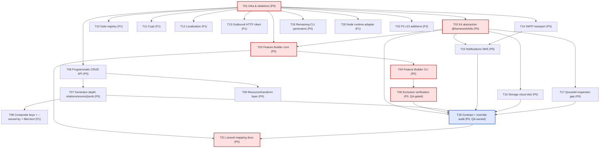

# Architecture Plan — Laravel v13 Parity Framework (ORM excluded)

**Author:** Bob (高见远), Architect · **Team:** `software-laravel-framework` · **Language:** English
**Consumer:** `software-engineer` + `software-qa-engineer` · **Status:** Ready for implementation
**Primary inputs:** `docs/requirements/laravel-parity-scope.md` (PM brief), `docs/status.md`, `docs/architecture/decisions.md` (ADR-1…ADR-11), `framwork.md`, `folder.md`, `packages/*/package.json`, real source under `packages/*/src` and `apps/playground`.

> **Grounding note.** `framwork.md` §1 is STALE — it calls this repo a "minimal Bun/Hono template". The repo is in fact a working 21-package framework with 427 passing tests, validated phases 0–6, a one-command CRUD generator, and five `@mohamedhabibwork/*` kits adapted behind framework contracts (see `docs/status.md`). This plan designs against the **real** package graph and existing seams; it does **not** re-plan finished work (brief §9). New layout follows the real one (`packages/*/src`, `apps/playground`), not the aspirational tree in `folder.md`.

---

## Part A — System Design

### 1. Implementation Approach

#### 1.1 Core technical challenges

| #   | Challenge                                                                   | Why it is hard                                                                                                                                                                                                   | Approach                                                                                                                                                                                                                                                                                      |
| --- | --------------------------------------------------------------------------- | ---------------------------------------------------------------------------------------------------------------------------------------------------------------------------------------------------------------- | --------------------------------------------------------------------------------------------------------------------------------------------------------------------------------------------------------------------------------------------------------------------------------------------- |
| C1  | **Feature Builder** (entirely net-new, highest risk)                        | Must resolve a feature→provider/config/route/command/artifact graph, fail _early and by name_, and make **removal mechanical and verifiable** — for both workspace (`workspace:*`) and published-npm consumption | A **Registry + Resolver + Plan** triple in a new `@framework/features` package. Declarations are data (`FeatureDescriptor`), resolution is a pure function producing a `FeaturePlan`, and verification is a separate tool that asserts the plan's exclusions mechanically (§1.3).             |
| C2  | **Kit→core wiring** (D3) without coupling core to 5 external packages       | `@framework/core` must be _aware_ of kits but must not depend on them; kits must stay swappable (ADR-11) and honest about capabilities                                                                           | A thin **`@framework/kits`** abstraction: `@framework/core` depends on the abstraction only; each kit is bound behind a stable **port**; concrete kit adapters live in the subsystem packages that already own them (`@framework/cache`, `-storage`, `-queue`, `-logging`, `-notifications`). |
| C3  | **One-line CRUD** at _runtime_, not just in a shell                         | The CLI path exists; the brief (P0-2, §4a #10) demands a programmatic `defineResource(table).crud()` producing the same 5 routes with the same contracts                                                         | A fluent **`ResourceBuilder`** in `@framework/crud` that reuses `ResourceService`/`ResourceController`/`resourceOperations` — no second CRUD implementation.                                                                                                                                  |
| C4  | **Generator depth** (relations, enums, jsonb, composite keys, `--owned-by`) | Must introspect Drizzle schema, resolve FKs, derive Zod, and refuse rather than guess                                                                                                                            | Extend the existing `packages/cli/src/generators/crud/*` pipeline (`introspect.ts`, `definition.ts`, `templates-*.ts`); new mixins for relation loading and composite keys.                                                                                                                   |
| C5  | **Full customization** with a _measurable_ gate                             | "Every component is replaceable" is unverifiable unless each subsystem has a contract + default binding + an override test                                                                                       | Per-subsystem **contract + default binding + one override test**; the audit is a task (T18), not a claim.                                                                                                                                                                                     |
| C6  | **Honest tree-shaking**                                                     | A runtime `if (enabled)` guard is _not_ removal (brief §4b #9)                                                                                                                                                   | Removal = package-dependency removal + build-time exclusion (+ optional source pruning), proven by a dependency-graph assertion + `bun install --frozen-lockfile` (brief §4b #4).                                                                                                             |
| C7  | **SOLID + patterns auditable**                                              | The user requires it "throughout"; assertions are worthless                                                                                                                                                      | A per-subsystem pattern table (§1.6) mapping each subsystem to the concrete SOLID principle / pattern already in the code, with the new work extending—not replacing—those patterns.                                                                                                          |

#### 1.2 Framework & library selections (justification)

The stack is **already pinned and validated**; the plan adds the minimum to close gaps. No new runtime, no new ORM, no second query engine.

| Concern              | Choice                                                                                   | Justification                                                                                                                                 |
| -------------------- | ---------------------------------------------------------------------------------------- | --------------------------------------------------------------------------------------------------------------------------------------------- |
| Runtime              | **Bun 1.4.2** (primary, ADR-1)                                                           | Already the only validated runtime; tests, server, worker, CLI all run on Bun.                                                                |
| Runtime (secondary)  | **Node** via an explicit adapter (P1, T20)                                               | Brief Q7 assumption: supported but secondary; new adapter + test matrix, no default flip.                                                     |
| HTTP                 | **Hono 4.13.12** (native)                                                                | Preserve native `Context`/`next()`/`onError` (invariant). No wrapper.                                                                         |
| Validation           | **Zod 4.6.5** + `@hono/zod-validator 0.9.1`                                              | `z.toJSONSchema` powers OpenAPI 3.1.                                                                                                          |
| Persistence          | **Drizzle ORM 0.45.3** + drizzle-kit 0.31.11 + drizzle-zod 0.8.3 (behind adapter, ADR-3) | ORM is out of scope; Drizzle is the query engine. Thin model metadata only.                                                                   |
| Feature Builder      | **Net-new `@framework/features`** (no external dep)                                      | Zero-dependency resolver keeps it tree-shakeable and publishable.                                                                             |
| Kit abstraction      | **Net-new `@framework/kits`** (no external dep)                                          | Pure types + a registry; must be safe for `@framework/core` to depend on.                                                                     |
| SMTP (P0-5)          | **`nodemailer`** (peer, optional)                                                        | Battle-tested, Bun-compatible; loaded behind `MailTransport` adapter so the peer stays optional (matches the "optional peer SDK" build rule). |
| SMS (P0-4)           | **`@mohamedhabibwork/notifykit`** SMS channel                                            | Never reimplement (ADR-11); surface the channel through NotifyKit.                                                                            |
| Cloud disk (P0-4)    | **`@mohamedhabibwork/storagekit`** s3 driver + MinIO in compose                          | Validate one cloud disk against real infra (brief §4d #4).                                                                                    |
| Crypt (P1-2)         | **`node:crypto`** AES-256-GCM                                                            | No dependency; mirrors the existing `node:crypto` TOTP usage.                                                                                 |
| Outbound HTTP (P1-4) | **native `fetch`** + retry helper                                                        | Already available on Bun/Node; no dependency.                                                                                                 |
| Localization (P1-3)  | native + Hono `language` middleware                                                      | Spec §11 already names Hono's `language`; catalog format is framework-owned.                                                                  |
| Gate (P1-1)          | native                                                                                   | Closure-based abilities over the existing `hasAbility`/policy plumbing.                                                                       |

#### 1.3 Architecture patterns (the Feature Builder in depth)

**Pattern: Builder + Registry + Resolver + Plan** (extends the established `CommandRegistry`, `MiddlewareRegistry`, `provider order` style).

**(1) Declaration surface** — a single file, data-only:

```ts
// bootstrap/features.ts  (generated by `create`; the ONE declaration point)
import { defineFeatures } from '@framework/features';
export const features = defineFeatures([
  'http',
  'validation',
  'database',
  'auth',
  'cache',
  'queue',
  'events',
  'scheduler',
  'workflow',
  'storage',
  'mail',
  'notifications',
  'logging',
  'openapi',
  'testing',
  'cli',
  'realtime',
  'ai-mcp',
]);
```

**(2) Feature descriptor** — the feature→everything mapping, declared once in the framework catalog:

```ts
interface FeatureDescriptor {
  readonly name: FeatureName;
  readonly requires: readonly FeatureName[]; // prerequisite graph
  readonly providers: readonly ProviderFactory[]; // e.g. createCacheProvider
  readonly configSection?: ConfigSectionRef; // zod fragment + key
  readonly routes?: readonly RouteFamilyRef[]; // e.g. '/api/v1/auth'
  readonly commands?: readonly string[]; // CLI names it owns
  readonly packages: readonly PackageRequirement[]; // @framework/* + kit deps
  readonly artifacts?: readonly string[]; // generator markers it feeds
  readonly tier: 'core' | 'p0' | 'p1' | 'p2';
}
```

**(3) Resolver** — pure, total, and _fail-fast_:

- `validate()` at registry build: **unknown feature ⇒ parse-time error** (`UNKNOWN_FEATURE`) — brief §4b #5.
- `resolve(enabled)`: topologically sorts by `requires`; **a missing prerequisite throws `MISSING_PREREQUISITE` at bootstrap with the exact feature name** — never a runtime crash (brief §4b #5). Cycles throw `FEATURE_CYCLE`.
- Produces a **`FeaturePlan`**: `{ enabled, order, excluded, providers, packages, excludedPackages, commands, routeFamilies }`. `isFullProfile()` is true when every catalog feature is enabled — the **full profile reproduces today's `create` output exactly** (brief §4b #8, assumption A3).
- **Compatibility matrix declared in code** (brief §4b #6): `queue → core`, `workflow → database + queue`, `notifications → mail (email channel) | standalone`, `scheduler → queue`, `auth → database`, etc. The matrix _is_ the `requires` graph; it is documented by `feature:list`.

**(4) Removal — D1 honored, both modes selectable:**

| Mode                                               | What it does                                                                                                                                      | Default?   |
| -------------------------------------------------- | ------------------------------------------------------------------------------------------------------------------------------------------------- | ---------- |
| **Default (dependency removal + build exclusion)** | Remove the subsystem's `@framework/*` (+ kit) entry from `package.json`, update the lockfile, exclude it from the build. **Sources stay intact.** | ✅ default |
| **`--prune-sources` (opt-in)**                     | Additionally prune the subsystem's _framework-owned_ source files (never user code).                                                              | opt-in     |

Both modes satisfy the **same mechanical invariants** (brief §4b #4). Removal is non-destructive to user code (brief §4b #7): a generated module that referenced a removed feature fails at **compile time** pointing at the removed feature (the import of `@framework/x` no longer resolves), never silent breakage.

**(5) CLI surface** (`@framework/cli`, group `feature`):

```
feature:list                 # declared + enabled + availability (from the descriptor catalog)
feature:add <name>           # wires the feature: features.ts + package.json + bun install + provider check
feature:remove <name>        # unwires it + dependency; refuses (exit 3) when dependents remain
feature:remove <name> --prune-sources   # + source pruning
feature:check                # verifies the exclusion invariants of the current plan
```

All mutation commands honor `--dry-run` (writes nothing) and the `{command,status,data,warnings}` JSON envelope, reusing the existing `packages/cli/src/generators/plan.ts` staged-apply/rollback machinery.

**`feature:check --json` is a stable, machine-readable contract** (locked by a test so the docs can quote it verbatim). It reuses the existing CLI envelope (`packages/cli/src/run.ts` → `envelope()`); exit `0` when all invariants pass, nonzero otherwise, with `status: "error"` + a safe `{code,message}` on failure:

```jsonc
{
  "command": "feature:check",
  "status": "ok", // "ok" | "error"
  "data": {
    "ok": true,
    "features": {
      "enabled": ["http", "validation", "database"],
      "excluded": ["queue", "cache"],
      "order": ["http", "validation", "database"],
    },
    "invariants": [
      { "id": "typecheck", "ok": true, "detail": "tsc --noEmit clean" },
      { "id": "build", "ok": true, "detail": "bun build ok" },
      { "id": "boot", "ok": true, "detail": "application booted" },
      { "id": "suite", "ok": true, "detail": "N tests passed" },
      { "id": "excluded-imports", "ok": true, "detail": "0 imports of 2 excluded @framework/* packages" },
      { "id": "frozen-lockfile", "ok": true, "detail": "bun install --frozen-lockfile clean" },
    ],
  },
  "warnings": [],
}
```

> **FROZEN CONTRACT — locked by the T05 test.** Two fields are load-bearing; renaming either requires updating the T05 test AND every doc that quotes them (this section is the single source of truth):
>
> - `data.invariants[].id` — the **six-value enum** `typecheck | build | boot | suite | excluded-imports | frozen-lockfile`. Docs must document exactly this set (anti-drift: a renamed ID must break the build, not silently rot the doc).
> - `data.features.excluded` — the "remove a feature" walkthrough quotes this array verbatim.
>
> `data.features.enabled` / `data.features.order` are stable-but-not-load-bearing. Note the two distinct sources: the Feature Builder **catalog** (`packages/features/src/catalog.ts` `FeatureName` union) is what proves every feature is documented; `feature:check` output is what docs quote as **evidence**.

**(6) Mechanical verification invariants** (`feature:check`, T05) — run against the plan's `excluded` set:

1. `bun run typecheck` clean.
2. `bun run build` succeeds.
3. the app **boots** (features register + boot).
4. the app **passes its suite**.
5. **dependency-graph assertion**: zero static imports of any excluded `@framework/*` (or kit) package anywhere reachable from the app entry points — an import-walk, not a grep.
6. `bun install --frozen-lockfile` succeeds in a **clean tree** (proves the manifest/lockfile edit is coherent).

The verification runs the brief's 3-feature fixture app (`features: ['http','validation','database']`, assumption A2) as the canonical exclusion gate.

#### 1.4 The kit-abstraction layer (D3)

- **`@framework/kits`** defines five narrow **ports** (ISP): `CachePort`, `StoragePort`, `QueueTransportPort`, `LoggerPort`, `NotificationPort`; a **`KitAdapter`** shape (`kit`, `version`, `port`, `capabilities`, `create`); a **`KitRegistry`**; and a **`KitCapabilities`** report.
- **`@framework/core` depends on `@framework/kits`** (and nothing else new). Core binds a `KIT_REGISTRY` token.
- Each subsystem package (`@framework/cache`, `-storage`, `-queue`, `-logging`, `-notifications`) registers its **concrete kit adapter** at provider `register` time. The `@mohamedhabibwork/*` import stays _inside that adapter_ (ADR-11 preserved — a kit bump is a one-file change, proven by a test that swaps the adapter, brief §4d #6).
- Application code resolves the **subsystem contract** from the container by token — never the kit (brief §4d #2).
- **Capability gaps are surfaced, never reimplemented** (ADR-11, brief §4d #3): `capabilities().assert(op)` throws a catalogued `CAPABILITY_UNSUPPORTED` with the kit name + version. The known gaps (cachekit Redis tags/namespace-clear, queuekit 0.4.1 inspection, storagekit cloud drivers, notifykit SMS) are closed in T15/T16/T17 **through the kits**, or kept as a _documented direct path_ — never a silent second implementation.

#### 1.5 One-line CRUD & full customization

- **Programmatic one-call API** (net-new, P0-2): `defineResource(table).schema({...}).access('authenticated').ownedBy('userId').relations({...}).crud()`. `.crud()` returns a `ResourceRegistration`; `registerResource(http, reg)` mounts the **same 5 native Hono routes** the CLI emits, using the **existing** `ResourceService`, `ResourceController`, `resourceOperations` (no duplication). Public access is never silently generated (ADR-8): `.access(...)` is required.
- **CLI path** already exists (`make:crud --verify`); T07/T08 deepen it (relations/enums/jsonb/composite keys/`--owned-by`) by extending `generators/crud/*`.
- **Full customization** is enforced by the **contract + default binding + override test** triple per subsystem (§1.6 table, task T18). The measurable gate: one override test per subsystem; count(contracts) == count(subsystems); no `any` at contract boundaries (`JsonValue`/`ServiceValue` discipline).

#### 1.6 SOLID + design-pattern mapping (auditable, per subsystem)

| Subsystem                                 | SRP                                            | OCP                          | LSP                                | ISP                                   | DIP                                     | Patterns                                       | New work                                            |
| ----------------------------------------- | ---------------------------------------------- | ---------------------------- | ---------------------------------- | ------------------------------------- | --------------------------------------- | ---------------------------------------------- | --------------------------------------------------- |
| core (container/providers)                | container vs scope vs providers                | deferred providers           | Resolver impls                     | `Resolver` narrow                     | providers bind contracts                | Registry, Factory, Template Method (lifecycle) | depend on `@framework/kits`                         |
| features (**new**)                        | registry / resolver / catalog / plan separated | add feature = add descriptor | —                                  | `FeatureDescriptor` is data           | resolver depends on catalog abstraction | **Builder, Registry, Resolver, Strategy**      | entire package                                      |
| kits (**new**)                            | port / adapter / registry separated            | new kit = new adapter        | all kits satisfy port              | 5 narrow ports                        | core→abstraction, subsystem→kit         | **Ports & Adapters, Registry, Strategy**       | entire package                                      |
| http                                      | kernel vs routing vs errors                    | native middleware unchanged  | —                                  | `ActorResolver`, limiter              | middleware via DI                       | Middleware/Decorator, Template Method          | feature routes wiring                               |
| crud                                      | service vs controller vs transform             | mixins extend ops            | repository structural              | `CrudRepository`, `ResourceTransform` | service→repo contract                   | **Template Method, Builder, Strategy**         | `defineResource`, relations, transform, filter/sort |
| database                                  | connections vs transactions vs mixins          | new op = new mixin           | all repos satisfy `CrudRepository` | narrow mixins                         | DataContext seam                        | **Mixin (OCP), Factory, Adapter (ADR-3)**      | composite-key + relation mixins                     |
| auth                                      | guards vs providers vs policies vs gate        | new guard = new Strategy     | guards satisfy contract            | `UserProvider`, `Guard`               | policies via DI                         | **Strategy, Factory**                          | **Gate registry**                                   |
| cache/queue/storage/logging/notifications | manager vs adapter                             | new engine = new adapter     | all satisfy port                   | capability-scoped ops                 | manager→port                            | **Adapter, Strategy, Registry**                | kit-gap closure via ports                           |
| mail                                      | builder vs transport                           | new transport = new Strategy | transports satisfy `MailTransport` | `MailTransport`                       | Mailer→transport                        | **Builder, Strategy, Factory**                 | SMTP transport                                      |
| support                                   | helpers separated                              | —                            | —                                  | —                                     | —                                       | Facade-like helpers                            | Crypt, localization, `Collection`/`Str`/`Arr`       |
| openapi                                   | metadata vs generation                         | new op = new metadata        | —                                  | —                                     | —                                       | Registry                                       | operations for new resources                        |
| cli                                       | parser vs registry vs generators               | new cmd = new `Command`      | all commands satisfy `Command`     | `Command`                             | project adapter                         | **Command, Registry, Builder (plan)**          | `feature:*`, generator depth, remaining generators  |
| workflow                                  | workflow→pipeline→stage→action                 | new action = new unit        | actions satisfy contract           | narrow action contract                | engine→store                            | **Saga/Compensation, Template Method**         | (reuse for removal rollback if needed)              |

#### 1.7 Invariants that must survive (from brief §7)

1. Native Hono `Context`/`Request`/`Response`/`next()` behaviour preserved; native middleware keeps working.
2. Error boundary is Hono's `onError`, **never** a `try/catch` around `await next()` (ADR-5).
3. Registration is **explicit** with `// @framework:*` markers; missing markers and duplicates are errors (ADR-6). The Feature Builder must reuse `insertAfterMarker`/`addImport` — never arbitrary text insertion.
4. Migrations are a **release step**, never on server/worker boot (ADR-9).
5. Capabilities are **reported honestly**, never faked (ADR-11).
6. **Public access is never silently generated** (ADR-8).
7. `bun run test` (427 tests) stays green throughout (assumption A1); the full profile reproduces today's `create` output (assumption A3).

---

### 2. File List

#### 2.1 Net-new files

**Feature Builder** — `packages/features/`

```
packages/features/package.json
packages/features/tsconfig.json
packages/features/src/index.ts            # public API: defineFeatures, FeatureRegistry, FeatureResolver, types
packages/features/src/types.ts            # FeatureName, FeatureDescriptor, FeaturePlan, PackageRequirement, FeatureTier
packages/features/src/registry.ts         # FeatureRegistry (register/get/all/validate)
packages/features/src/resolver.ts         # FeatureResolver (topoSort, prerequisite + cycle checks)
packages/features/src/catalog.ts          # the descriptor catalog for all 18 subsystems
packages/features/src/plan.ts             # FeaturePlan construction + isFullProfile()
packages/features/src/errors.ts           # FeatureError (UNKNOWN_FEATURE, MISSING_PREREQUISITE, FEATURE_CYCLE)
packages/features/tests/registry.test.ts
packages/features/tests/resolver.test.ts
packages/features/tests/catalog.test.ts
```

**Kit abstraction** — `packages/kits/`

```
packages/kits/package.json
packages/kits/tsconfig.json
packages/kits/src/index.ts                # public API: KitRegistry, ports, KitAdapter, KIT_REGISTRY token
packages/kits/src/types.ts                # KitPortName, KitAdapter, KitCapabilities, CapabilityState
packages/kits/src/ports.ts                # CachePort, StoragePort, QueueTransportPort, LoggerPort, NotificationPort
packages/kits/src/registry.ts             # KitRegistry (register/adapterFor/capabilities)
packages/kits/src/capabilities.ts         # CapabilityReport helper + assert()
packages/kits/src/constants.ts            # KIT_REGISTRY token
packages/kits/src/errors.ts               # CapabilityError (CAPABILITY_UNSUPPORTED)
packages/kits/tests/registry.test.ts
```

**Feature CLI** — `packages/cli/src/`

```
packages/cli/src/commands/feature.ts      # feature:list|add|remove|check commands
packages/cli/src/features/manifest.ts     # package.json + lockfile editing (workspace:* and npm)
packages/cli/src/features/wiring.ts       # bootstrap/features.ts + providers.ts edits (marker-based)
packages/cli/src/features/exclusion.ts    # dependency-graph assertion (zero imports of excluded pkgs)
packages/cli/src/features/verify.ts       # the 6 mechanical invariants runner
packages/cli/src/features/prune.ts        # --prune-sources file pruning
packages/cli/tests/features.test.ts
```

**One-line CRUD + depth** — `packages/crud/src/`

```
packages/crud/src/resource.ts             # defineResource() + ResourceBuilder
packages/crud/src/register-resource.ts    # registerResource(http, registration) mounts native routes
packages/crud/src/relations.ts            # relation metadata + allowlisted ?include= loading
packages/crud/src/transform.ts            # ResourceTransform declarative projection
packages/crud/src/filter-sort.ts          # validated ?filter[field][op]= / ?sort= DSL
packages/crud/tests/resource.test.ts
packages/crud/tests/relations.test.ts
packages/crud/tests/transform.test.ts
packages/crud/tests/filter-sort.test.ts
```

```
packages/cli/src/generators/crud/relations.ts     # FK introspection → belongsTo/hasMany metadata
packages/cli/src/generators/crud/enums.ts         # pgEnum → z.enum, jsonb → schema
packages/cli/src/generators/crud/composite.ts     # composite/non-id primary keys
packages/cli/src/generators/crud/ownership.ts     # --owned-by flag wiring
```

**New subsystems / closures**

```
packages/auth/src/gate.ts                 # Gate registry (define/before/after/allows/denies)   [P1-1]
packages/support/src/crypt.ts             # Crypt AES-256-GCM encrypt/decrypt (+ rotate)         [P1-2]
packages/support/src/collection.ts        # Collection + Str/Arr helpers                          [P2-4]
packages/http/src/client/client.ts        # outbound Http:: (fetch + retry/timeout/json)          [P1-4]
packages/http/src/client/fake.ts          # test fake transport
packages/http/src/localization/translator.ts  # __() + locale switching + catalogs               [P1-3]
packages/http/src/localization/middleware.ts
packages/mail/src/smtp-transport.ts       # SMTP transport (nodemailer peer)                      [P0-5]
packages/notifications/src/sms-channel.ts # SMS channel over NotifyKit                            [P0-4]
packages/storage/src/cloud-disk.ts        # cloud disk over StorageKit (s3/minio)                 [P0-4]
packages/queue/src/inspection.ts          # queuekit inspection port + documented direct path     [P0-4]
packages/cache/src/touch.ts               # Cache::touch (extends TTL)                            [P1-8]
```

**Node runtime adapter (P1)** — `packages/core/src/`

```
packages/core/src/runtime/runtime-adapter.ts   # RuntimeAdapter contract (server/worker/serve)
packages/core/src/runtime/bun-adapter.ts        # existing Bun behaviour behind the contract
packages/core/src/runtime/node-adapter.ts       # Node adapter (@hono/node-server)
packages/cli/templates/application/runtimes/node/  # node template tree
```

**P2 v13 additions (opt-in, catalogued P2)**

```
packages/crud/src/json-api.ts             # JSON:API resources                          [P2-1]
packages/auth/src/passkey.ts              # passkey / WebAuthn additive guard           [P2-2]
packages/ai/src/index.ts                  # AI SDK / agents / semantic search           [P2-9]
```

**Docs & fixtures**

```
docs/architecture/laravel-concept-map.md          # Laravel concept → framework equivalent
apps/docs/src/content/docs/guides/laravel-mapping.mdx
apps/docs/src/content/docs/guides/feature-builder.mdx
apps/minimal-feature/                              # the 3-feature exclusion fixture (A2)
  bootstrap/features.ts  bootstrap/providers.ts  bootstrap/http.ts  package.json  tsconfig.json
```

#### 2.2 Modified files

```
package.json                                  # add packages/features, packages/kits, apps/minimal-feature to workspaces
tsconfig.base.json                            # add path refs for new packages (if referenced)
packages/core/package.json                    # + "@framework/kits": "workspace:*"
packages/core/src/application.ts              # accept a resolved FeaturePlan (or derive providers from it)
packages/core/src/index.ts                    # re-export kit-registry + feature integration seams
packages/cache/package.json                   # + "@framework/kits"
packages/cache/src/provider.ts                # register CacheKitAdapter into KitRegistry
packages/storage/src/provider.ts              # register StorageKitAdapter
packages/queue/src/queuekit-adapter.ts        # register QueueKitAdapter + inspection port
packages/logging/src/*                        # register LoggerKitAdapter
packages/notifications/src/provider.ts        # register NotifyKitAdapter
packages/mail/src/provider.ts                 # + smtp driver selection
packages/http/src/index.ts                    # export client + localization
packages/support/src/index.ts                 # export crypt + collection
packages/crud/src/index.ts                    # export defineResource/registerResource/transform/filter-sort/relations
packages/cli/src/commands/index.ts            # register featureCommands + newly implemented generators
packages/cli/src/commands/planned.ts          # remove commands that become implemented
apps/playground/bootstrap/features.ts         # NEW declaration file; providers.ts derives from the plan
apps/playground/bootstrap/providers.ts        # consume FeaturePlan.providers
apps/playground/package.json                  # feature-set deps
apps/playground/app/modules/products/index.ts # optionally migrate to defineResource(...).crud()
.github/workflows/ci.yml                      # add feature:check + node matrix jobs
docs/status.md                                # update release classification as work lands
docs/architecture/decisions.md                # new ADRs: ADR-12 (Feature Builder), ADR-13 (kit abstraction), ADR-14 (Node runtime adapter), ADR-15 (migrations forward-only; db:rollback closed)
```

---

### 3. Data Structures & Interfaces

Full diagram: `docs/architecture/class-diagram.mermaid` (Feature Builder registry/resolver/descriptor/plan, kit ports + adapters, CRUD resource contract/mixins, provider/container seams). Key contracts summarized:

```ts
// @framework/features
type FeatureName =
  | 'http'
  | 'validation'
  | 'database'
  | 'auth'
  | 'cache'
  | 'queue'
  | 'events'
  | 'scheduler'
  | 'workflow'
  | 'storage'
  | 'mail'
  | 'notifications'
  | 'logging'
  | 'openapi'
  | 'testing'
  | 'cli'
  | 'realtime'
  | 'ai-mcp';

interface FeatureDescriptor {
  /* see §1.3(2) */
}
interface FeaturePlan {
  readonly enabled: readonly FeatureName[];
  readonly order: readonly FeatureName[];
  readonly excluded: readonly FeatureName[];
  readonly providers: readonly ServiceProvider<never>[];
  readonly packages: readonly PackageRequirement[];
  readonly excludedPackages: readonly string[];
  readonly commands: readonly string[];
  readonly routeFamilies: readonly string[];
}
declare function defineFeatures(names: readonly FeatureName[]): readonly FeatureName[];
class FeatureResolver {
  constructor(registry: FeatureRegistry);
  resolve(enabled: readonly FeatureName[]): FeaturePlan;
}
class FeatureError extends FrameworkError {
  readonly code: 'UNKNOWN_FEATURE' | 'MISSING_PREREQUISITE' | 'FEATURE_CYCLE' | 'FEATURE_IN_USE';
}
```

```ts
// @framework/kits
type KitPortName = 'cache'|'storage'|'queue-transport'|'logger'|'notification';
interface KitAdapter<TPort> {
  readonly kit: string; readonly version: string; readonly port: KitPortName;
  readonly capabilities: KitCapabilities; create(options: unknown): TPort;
}
class KitRegistry { register<TPort>(a: KitAdapter<TPort>): void; adapterFor(port: KitPortName): KitAdapter<unknown>; capabilities(port: KitPortName): KitCapabilities; }
const KIT_REGISTRY: Token<KitRegistry>;
```

```ts
// @framework/crud  (one-line API)
declare function defineResource<TTable extends CrudTable>(table: TTable): ResourceBuilder<TTable>;
interface ResourceBuilder<TTable> {
  schema(cfg: { create: ZodType; update: ZodType; response: ZodType }): this;
  access(mode: 'public' | 'authenticated'): this; // required — ADR-8
  ownedBy(field: string): this;
  relations(map: RelationMap): this;
  include(allowlist: readonly string[]): this;
  softDelete(): this;
  filterSort(dsl: FilterSortDsl): this;
  crud(): ResourceRegistration;
}
declare function registerResource(app: Hono<FrameworkEnv>, reg: ResourceRegistration): void;
```

---

### 4. Program Call Flow

Full diagrams: `docs/architecture/sequence-diagram.mermaid` — three flows: **(a)** application bootstrap with feature resolution, **(b)** one-line programmatic CRUD registration + a request, **(c)** `feature:remove` with the exclusion verification. Summarized:

- **(a)** `defineFeatures([...]) → FeatureResolver.resolve()` → `Registry.validate()` (unknown ⇒ parse error) → topo-sort + prerequisite check (missing ⇒ named bootstrap error) → `FeaturePlan` → `new Application({ providers: plan.providers })` → `orderProviders` → register loop (kit adapters register into `KitRegistry`) → boot loop.
- **(b)** `defineResource(products).schema(...).access(...).ownedBy(...).relations(...).crud()` → `ResourceRegistration` → provider binds service/controller/transform → `registerResource` mounts 5 native routes → request hits `ResourceController` → `ResourceService` (ownership scope + hooks) → `CrudRepository` → transform → public DTO.
- **(c)** `feature:remove queue` → dependent check (exit 3 if `workflow`/`scheduler` remain) → manifest edit → optional source prune → `features.ts` edit → `bun install --frozen-lockfile` → `feature:check` runs the 6 invariants → verified (not asserted).

---

### 5. Anything UNCLEAR

**Assumptions adopted** (from the task brief, resolving the PM's open questions):

| ID                          | Resolution                                                                                                                                                                 | Rationale                                                                                                                    |
| --------------------------- | -------------------------------------------------------------------------------------------------------------------------------------------------------------------------- | ---------------------------------------------------------------------------------------------------------------------------- |
| **Q2** Blade templating     | **Deferred**                                                                                                                                                               | `framwork.md` §11 makes rendering optional; Hono JSX is the optional path. Written decision goes in `docs/status.md`.        |
| **Q3** "except the ORM"     | **Thin model metadata allowed** (serialization/scopes/soft-delete/relation metadata over Drizzle); no second query engine, no Eloquent schema source.                      | `framwork.md` §5 explicitly permits thin metadata; needed to expose relations (P0-3).                                        |
| **Q7** Node runtime         | **Supported but secondary**; Bun remains the only _validated_ runtime (ADR-1). Node gets an explicit runtime adapter + test matrix (T20, P1).                              | Minimizes risk; keeps the validated-runtime claim honest.                                                                    |
| **Q8** Parity target        | **Behaviour parity where cheap, TypeScript-idiomatic equivalents otherwise**, with the mapping documented (T21).                                                           | TS idioms (e.g. `ResourceTransform` vs Laravel `JsonResource`) are accepted; the mapping doc closes the discoverability gap. |
| **Q1** v13 _new_ additions  | Catalogued at **P2** (JSON:API, passkey/WebAuthn, AI SDK/semantic search) except `Cache::touch` which is cheap → **P1-8**.                                                 | Honors D2 while protecting the P0 critical path.                                                                             |
| **Q4/D3** "into its core"   | **Thin `@framework/kits` abstraction that core depends on**; kits stay swappable behind ports.                                                                             | Honors D3; preserves ADR-11 and §4c replaceability.                                                                          |
| **Q5/D1** removal semantics | **Both, selectable** — default = dependency removal + build exclusion; `--prune-sources` = additionally prune sources.                                                     | Both satisfy the same mechanical invariants (brief §4b #4).                                                                  |
| **Q6/D4** distribution      | **Support all, Bun main** — versioning + peer-dep boundaries so `@framework/*` is npm-publishable and consumable by bun/pnpm/npm; removal works for `workspace:*` and npm. | Honors D4.                                                                                                                   |

**Genuinely open (needs a decision before/within the task):**

1. **Feature-plan source of truth at runtime.** Should `Application` accept a pre-resolved `FeaturePlan` (my recommendation: yes — keeps `Application` dumb and testable) or should it resolve features itself from `bootstrap/features.ts`? Recommendation: `Application` takes `providers`; a small `createApplicationFromFeatures(features)` helper (in `@framework/features`) does resolution. This keeps `@framework/core` free of a dependency on `@framework/features`.
2. **`feature:add` auto-install.** Whether `feature:add` runs `bun install` (default, like `create`) or leaves it to the user. Recommendation: run it unless `--no-install`, mirroring `create`.
3. **Source-prune safety boundary.** `--prune-sources` must only ever delete files under `packages/<subsystem>/` that the framework owns. A manifest of framework-owned paths per feature is required; user code is never touched. Confirm the boundary in T05.
4. **Kit-registry ownership.** Whether the `KitRegistry` is bound by `@framework/core` (so any subsystem can register) or by a dedicated `kits` provider. Recommendation: core binds the token; subsystems register during `register()`. Confirm in T02.
5. **`db:rollback` (P1-10).** Brief leaves "implement or formally close". Recommendation: **formally close as forward-only** (ADR-recorded), since migrations are a release step (ADR-9) and `db:fresh` covers non-prod reset. Confirm with PM.

---

## Part B — Task Decomposition

### 6. Required Packages

Existing pins are unchanged. New/added dependencies:

```
# runtime & toolchain (unchanged, pinned)
bun@1.4.2                      # only validated runtime (ADR-1)
typescript@5.9.3
@biomejs/biome@2.5.15
hono@4.13.12
zod@4.6.5
@hono/zod-validator@0.9.1
drizzle-orm@0.45.3
drizzle-kit@0.31.11
drizzle-zod@0.8.3
postgres@3.4.9
jose@6                         # JWT/JWK (existing)

# kits (unchanged, pinned exact)
@mohamedhabibwork/cachekit@0.2.1
@mohamedhabibwork/storagekit@0.6.1
@mohamedhabibwork/queuekit@0.4.1
@mohamedhabibwork/loggerkit@0.2.2
@mohamedhabibwork/notifykit@0.4.1
bullmq@6.3.11
ioredis@5.8.2

# NEW dependencies
@framework/features@0.1.0      # workspace:*, zero external deps (Feature Builder)
@framework/kits@0.1.0          # workspace:*, zero external deps (kit abstraction)

# NEW optional peers (loaded behind adapters; kept external in `build`)
nodemailer@^6                  # SMTP transport (P0-5) — peer, optional
@hono/node-server@^1           # Node runtime adapter (P1, T20) — peer, optional
# cloud disk uses storagekit's s3 driver (MinIO in compose) — no new direct dep
```

> Rule: new optional peers stay **external** in `bun build` (matches the existing "optional storage/notifications peer SDKs kept external" behavior).

---

### 7. Task List (ordered by dependency)

> **Hard rules honored:** T01 is project infrastructure (manifests + entry + deps in ONE task); every task groups **≥3 related files**; grouped by subsystem/layer, never one-file-per-task. The "≤5 tasks" cap is **relaxed** per the user's explicit request for a detailed, assigned breakdown → **22 tasks**.

| Task    | Name                                                                                       | Source files (from §2)                                                                                                                                                                                                                                       | Depends on | Priority | Owner                    | Parallelization note                                                                                                                           |
| ------- | ------------------------------------------------------------------------------------------ | ------------------------------------------------------------------------------------------------------------------------------------------------------------------------------------------------------------------------------------------------------------ | ---------- | -------- | ------------------------ | ---------------------------------------------------------------------------------------------------------------------------------------------- |
| **T01** | **Project infrastructure & new-package skeletons**                                         | `package.json` (workspaces), `tsconfig.base.json`, `packages/features/{package.json,tsconfig.json,src/index.ts}`, `packages/kits/{package.json,tsconfig.json,src/index.ts}`, `apps/minimal-feature/{package.json,tsconfig.json}`, `.github/workflows/ci.yml` | —          | P0       | software-engineer        | **Unblocks everything.** T02/T03/T06 can start once T01 lands; do not parallelize the skeleton edits.                                          |
| **T02** | **Kit-abstraction layer (`@framework/kits`)**                                              | `packages/kits/src/{types,ports,registry,capabilities,constants,errors}.ts`, `packages/kits/tests/registry.test.ts`, `packages/core/package.json`, `packages/core/src/index.ts`                                                                              | T01        | P0       | software-engineer        | Parallel with T03. Re-seats the 5 existing kit adapters behind ports.                                                                          |
| **T03** | **Feature Builder core (registry + resolver + catalog + plan)**                            | `packages/features/src/{types,registry,resolver,catalog,plan,errors}.ts`, `packages/features/tests/{registry,resolver,catalog}.test.ts`                                                                                                                      | T01, T02   | P0       | software-engineer        | Parallel with T02. **Highest-risk item — schedule an architect spike before coding.**                                                          |
| **T04** | **Feature Builder CLI (`feature:*`) + wiring**                                             | `packages/cli/src/commands/feature.ts`, `packages/cli/src/features/{manifest,wiring}.ts`, `packages/cli/src/commands/index.ts`, `apps/playground/bootstrap/features.ts`, `apps/playground/bootstrap/providers.ts`, `packages/cli/tests/features.test.ts`     | T03        | P0       | software-engineer        | Needs T03. Parallel with T06/T10–T17 (all only need T01).                                                                                      |
| **T05** | **Feature exclusion verification (`feature:check` + prune)**                               | `packages/cli/src/features/{exclusion,verify,prune}.ts`, `apps/minimal-feature/*`, `packages/cli/tests/features.test.ts`                                                                                                                                     | T04        | P0       | software-engineer        | **QA-gated** (QA signs off the 6 invariants). Sequential after T04.                                                                            |
| **T06** | **Programmatic one-line CRUD API**                                                         | `packages/crud/src/{resource,register-resource}.ts`, `packages/crud/src/index.ts`, `packages/crud/tests/resource.test.ts`, `apps/playground/app/modules/products/index.ts`                                                                                   | T01        | P0       | software-engineer        | Parallel with T02/T03. Only needs T01.                                                                                                         |
| **T07** | **Generator depth: relations + enums + jsonb**                                             | `packages/cli/src/generators/crud/{relations,enums}.ts`, `packages/crud/src/relations.ts`, `packages/crud/tests/relations.test.ts`                                                                                                                           | T06        | P0       | software-engineer        | Parallel with T08/T09 after T06.                                                                                                               |
| **T08** | **Composite keys + `--owned-by` + filter/sort DSL**                                        | `packages/cli/src/generators/crud/{composite,ownership}.ts`, `packages/crud/src/filter-sort.ts`, `packages/crud/tests/filter-sort.test.ts`                                                                                                                   | T07        | P1       | software-engineer        | Parallel with T09 after T07.                                                                                                                   |
| **T09** | **Declarative resource/transform layer**                                                   | `packages/crud/src/transform.ts`, `packages/crud/src/index.ts`, `packages/crud/tests/transform.test.ts`                                                                                                                                                      | T06        | P0       | software-engineer        | Parallel with T07/T08.                                                                                                                         |
| **T10** | **Gate registry (closure abilities)**                                                      | `packages/auth/src/gate.ts`, `packages/auth/src/index.ts`, `packages/auth/tests/gate.test.ts`                                                                                                                                                                | T01        | P1       | software-engineer        | Parallel (needs only T01).                                                                                                                     |
| **T11** | **Crypt (AES-256-GCM)**                                                                    | `packages/support/src/crypt.ts`, `packages/support/src/index.ts`, `packages/support/tests/crypt.test.ts`                                                                                                                                                     | T01        | P1       | software-engineer        | Parallel (needs only T01).                                                                                                                     |
| **T12** | **Localization (`__()`, locale, catalogs)**                                                | `packages/http/src/localization/{translator,middleware}.ts`, `packages/http/src/index.ts`, `packages/http/tests/localization.test.ts`                                                                                                                        | T01        | P1       | software-engineer        | Parallel (needs only T01).                                                                                                                     |
| **T13** | **Outbound HTTP client (`Http::`)**                                                        | `packages/http/src/client/{client,fake}.ts`, `packages/http/src/index.ts`, `packages/http/tests/client.test.ts`                                                                                                                                              | T01        | P1       | software-engineer        | Parallel (needs only T01).                                                                                                                     |
| **T14** | **SMTP mail transport**                                                                    | `packages/mail/src/smtp-transport.ts`, `packages/mail/src/provider.ts`, `packages/mail/src/index.ts`, `packages/mail/tests/smtp.test.ts`                                                                                                                     | T01        | P0       | software-engineer        | Parallel (needs only T01). Adds `nodemailer` optional peer.                                                                                    |
| **T15** | **Notifications SMS channel (NotifyKit)**                                                  | `packages/notifications/src/sms-channel.ts`, `packages/notifications/src/provider.ts`, `packages/notifications/tests/sms.test.ts`                                                                                                                            | T02, T14   | P0       | software-engineer        | Needs T02 (port) + T14 (email channel symmetry).                                                                                               |
| **T16** | **Storage cloud disk (MinIO/S3 via StorageKit)**                                           | `packages/storage/src/cloud-disk.ts`, `packages/storage/src/provider.ts`, `packages/storage/tests/cloud.test.ts`, `deployment/compose.yaml`                                                                                                                  | T02        | P0       | software-engineer        | Needs T02. Adds MinIO to compose for real-infra test.                                                                                          |
| **T17** | **Queuekit inspection-gap closure**                                                        | `packages/queue/src/inspection.ts`, `packages/queue/src/queuekit-adapter.ts`, `packages/queue/src/index.ts`, `packages/queue/tests/inspection.test.ts`                                                                                                       | T02        | P0       | software-engineer        | Needs T02. Preserves documented direct BullMQ path.                                                                                            |
| **T18** | **Contract + override audit (every subsystem)**                                            | one `*.override.test.ts` per subsystem under `packages/*/tests/`, `packages/*/src/index.ts` (contract exports), `docs/architecture/pattern-audit.md`                                                                                                         | T02–T17    | P0       | **software-qa-engineer** | **QA-owned.** Runs after the subsystem tasks land; the measurable gate (1 override test/subsystem; contracts == subsystems).                   |
| **T19** | **Remaining CLI generators + `integration:*`**                                             | `packages/cli/src/commands/{simple-generators,planned,infrastructure}.ts`, `packages/cli/src/generators/scaffolds/{slices,templates-runtime}.ts`, `packages/cli/tests/generators.test.ts`                                                                    | T01        | P0       | software-engineer        | Parallel (needs only T01). Closes `make:model/migration/guard/user-provider/mail/notification/command/schedule/integration` + `integration:*`. |
| **T20** | **Node runtime adapter + test matrix**                                                     | `packages/core/src/runtime/{runtime-adapter,bun-adapter,node-adapter}.ts`, `packages/cli/templates/application/runtimes/node/*`, `.github/workflows/ci.yml`                                                                                                  | T01        | P1       | software-engineer        | Parallel (needs only T01). Adds `@hono/node-server` optional peer.                                                                             |
| **T21** | **Laravel-concept mapping docs + Feature Builder docs**                                    | `docs/architecture/laravel-concept-map.md`, `apps/docs/src/content/docs/guides/{laravel-mapping,feature-builder}.mdx`                                                                                                                                        | T03, T18   | P0       | software-engineer        | Sequential-ish (needs T03 catalog + T18 audit results).                                                                                        |
| **T22** | **P2 v13 additions (JSON:API, passkey, AI SDK, `Collection`/`Str`/`Arr`, `Cache::touch`)** | `packages/crud/src/json-api.ts`, `packages/auth/src/passkey.ts`, `packages/ai/src/index.ts`, `packages/support/src/collection.ts`, `packages/cache/src/touch.ts`, per-package tests                                                                          | T01        | P2       | software-engineer        | Fully parallel (each opt-in, needs only T01). `Cache::touch` is cheap → may be pulled into the P1 path.                                        |

#### 7.1 Owner-assignment summary

| Owner                    | Tasks                                                                                                   | Count            |
| ------------------------ | ------------------------------------------------------------------------------------------------------- | ---------------- |
| **software-engineer**    | T01, T02, T03, T04, T05, T06, T07, T08, T09, T10, T11, T12, T13, T14, T15, T16, T17, T19, T20, T21, T22 | 21               |
| **software-qa-engineer** | T18 (+ QA sign-off gate on T05)                                                                         | 1 owned, 2 gated |
| **software-architect**   | T03 pre-implementation spike (Feature Builder design validation)                                        | 0 owned, 1 spike |

#### 7.2 QA tasks (regression + exclusion-invariant verification)

- **T05 — exclusion-invariant verification (QA-gated):** QA independently confirms the 6 mechanical invariants of `feature:check` on the `apps/minimal-feature` fixture (`features: ['http','validation','database']`): typecheck, build, boot, suite, zero imports of excluded `@framework/*`, clean `bun install --frozen-lockfile`. Evidence required in the task's acceptance.
- **T18 — contract + override audit (QA-owned):** one override test per subsystem; assert `count(subsystems with a contract) == count(subsystems)`; verify no `any`/`unknown` leakage at contract boundaries; verify capabilities are honest (unsupported ops throw, never fake).
- **Continuous regression (QA responsibility across all tasks):** the existing 427-test suite (`bun run test`) + `bun run coverage` + `bun run typecheck` + `bun run lint` must stay green after every merge; the full-profile `create` output must be byte-equivalent to today (assumption A3). The generated-app gate (`packages/cli/tests/create-app.test.ts`, `generated-app.test.ts`) must keep passing.

---

### 8. Shared Knowledge

Cross-cutting conventions the engineer MUST follow:

1. **Registration markers.** All cross-file registration uses `// @framework:*` markers via `insertAfterMarker`/`addImport` (`packages/cli/src/generators/registration.ts`). Missing markers and duplicates are **errors**, never silent text insertion (ADR-6). The Feature Builder reuses this machinery — no new insertion strategy.
2. **Error catalog.** Every new failure code is added to `@framework/core` `ERROR_CATALOG` (shared) and mapped to an HTTP status where relevant. Feature/kit errors: `UNKNOWN_FEATURE`, `MISSING_PREREQUISITE`, `FEATURE_CYCLE`, `FEATURE_IN_USE`, `CAPABILITY_UNSUPPORTED`. CLI failures use `CliError` with the exit-code contract (`0/1/2/3/130`).
3. **Capabilities honesty (ADR-11).** A subsystem that cannot perform an operation **throws** a catalogued `CAPABILITY_UNSUPPORTED` naming the kit + version — it never fakes success and never adds a silent second implementation. Where a documented direct path exists (queuekit inspection via BullMQ), it is labelled as such in code and docs.
4. **No `any` at contract boundaries.** Public contracts use `JsonValue`/`JsonObject`/`ServiceValue` discipline. Generated DTO boundaries must not depend on `any` or unsafe assertions (`framwork.md` mixin requirements).
5. **Explicit public access (ADR-8).** `defineResource(...)` and `make:crud` **require** an explicit access mode; public access is never silently generated.
6. **Migrations are a release step (ADR-9).** No server/worker boot migration. New tables/migrations are generated artifacts applied via `db:migrate`.
7. **Native Hono + `onError` (ADR-5).** No `try/catch` around `await next()`. Native middleware keeps working; the kernel's fixed order is preserved.
8. **Feature plan is data.** Resolution is pure; `Application` stays dumb (takes `providers`). `@framework/core` does NOT depend on `@framework/features` (only on `@framework/kits`).
9. **Test strategy.** Unit tests for pure logic (resolver, gate, crypt, filter-sort); HTTP feature tests for routes; **real-infrastructure** tests for kit-backed subsystems (Postgres/Redis/MinIO) — fakes are never evidence of real behaviour; the generated-app gate for `create`/`make:crud`; the 3-feature fixture for exclusion.
10. **ADR compliance.** New decisions get ADRs: ADR-12 (Feature Builder), ADR-13 (kit abstraction), ADR-14 (Node runtime adapter). ADR-1/3/5/6/8/9/11 remain binding.
11. **Versioning & distribution (D4).** `@framework/*` packages get a real `version` + `exports` map and peer-dep boundaries so they publish to npm; the Feature Builder's manifest editor must handle both `workspace:*` and semver ranges.
12. **Package graph rule.** `@framework/core` depends only on `@framework/kits` (+ zod). No subsystem may import a kit directly outside its adapter module. `@framework/features` depends on nothing but `@framework/core` types.

---

### 9. Task Dependency Graph



**Critical path (P0):** `T01 → T02 → T03 → T04 → T05 → T18 → T21`.
**Maximum parallelism:** after T01, the subsystem tasks (T06–T17, T19, T20, T22) run concurrently; the CRUD chain (T06→T07→T08/T09) and the feature chain (T02→T03→T04→T05) are the only significant linear runs.
